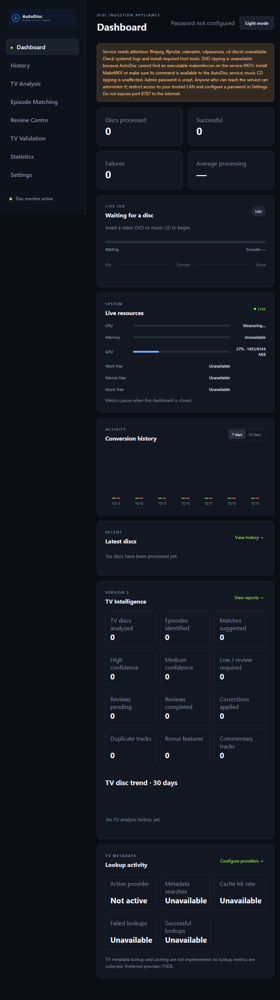
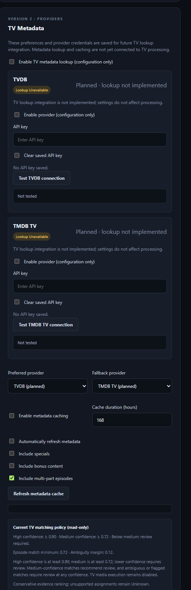

# AutoDisc

AutoDisc is an easy-to-use DVD and music CD ingestion appliance for Linux and Jellyfin. It works two ways:

- As a friendly web dashboard you can open from your browser to watch progress, tweak settings, and manage jobs.
- Headless as a lightweight systemd service for fully automated ripping and conversion.

AutoDisc watches a configured optical drive, uses MakeMKV and FFmpeg for DVDs and cdparanoia for audio CDs, then publishes finished movies to your Movies library and lossless FLAC albums to Music.

## Dashboard preview





Screenshots are from the Windows development preview; the dashboard warning
reflects Linux runtime tools that are unavailable in that preview environment.

## Quick start

Get AutoDisc up and running in a few minutes:

1. Install on a fresh Lubuntu/Ubuntu or Debian host (this installs Node, FFmpeg, cdparanoia, and helper tools):

```sh
sudo apt-get update && sudo apt-get install -y curl ca-certificates && \
  curl --fail --silent --show-error --location https://github.com/nick709r/DVDTOJELLYFIN/archive/refs/heads/main.tar.gz --output autodisc.tar.gz && \
  tar xzf autodisc.tar.gz && cd DVDTOJELLYFIN-main && sudo ./installer.sh
```

2. (Optional) Install MakeMKV separately to enable DVD ripping — AutoDisc does not bundle MakeMKV. When MakeMKV is installed and `makemkvcon` is on the service PATH, DVD ripping is enabled.

3. Open the web dashboard from another device on your LAN:

   - Find the server LAN IP with `hostname -I` and open `http://<server-lan-ip>:8787`.
   - The first-run dashboard has no password so you can get started quickly; set an administrator password in Settings after you confirm access is restricted to your trusted LAN.

4. Configure your Movies, Music, and TV root folders, work directory, and optical drive in Settings. TV output is currently only validated; TV publishing is not enabled. Test with a known DVD and an audio CD to confirm encoder, tags, paths, cleanup, and eject behavior.

Quick commands:

- Check service status and logs:

```sh
sudo systemctl status autodisc.service
sudo journalctl -u autodisc.service -f
```

- Stop the service and make a backup of the database:

```sh
sudo systemctl stop autodisc.service
sudo cp /var/lib/autodisc/autodisc.sqlite /var/lib/autodisc/autodisc.sqlite.bak
```

That's it — the dashboard gives you live job progress and simple controls, or run entirely headless as a systemd service for fully automated operation.

## Release history

### Version 1.14.0

- Add a disk classification review and audit system for every media type
  (DVD, Blu-ray, CD Audio, CD-ROM, Mixed Mode, Unknown and future types).
  Disk Monitor shows the original detection, nullable confidence and review
  status, and lets operators override the type with a structured reason and
  notes. The original detection is never overwritten.
- Add an append-only audit table (migration 16, never auto-deleted), a
  plain-text operator log export (`/api/v1/classification/export/text`), a JSON
  export for classifier/LLM analysis (`/api/v1/classification/export/json`) and
  metrics (`/api/v1/classification/metrics`) derived from audit records.

### Version 1.13.0

- Fix optical-drive monitoring so a media-change event after an earlier
  inspection failure starts a fresh disc scan instead of remaining latched in
  the waiting state.
- Reset inspection retry backoff when media changes, while retaining
  fingerprint-based protection against processing the same disc twice.

### Version 1.12.0

- Add a live Disc Diagnostics dashboard page for drive detection, source
  provider attempts, disc structure, classification scorecards, TV analysis,
  episode matching, metadata results, pipeline events, and job logs.
- Persist structured source manifests and TV analysis/metadata outcomes in job
  history; stream event updates to the diagnostics page while it is open.
- Report metadata provider fallback and per-result cache use where available.
  Explicitly identify chapter counts, audio track lengths, and empty-result
  cache state when current providers do not expose them.
- Keep resource metrics scoped to the Dashboard; Disc Diagnostics does not
  start a separate system resource sampler.

### Version 1.11.0

- Add explainable DVD TV classification with a confidence scorecard and
  per-criterion pass/fail details in job history and service logs.
- Hold uncertain two-episode and other TV-shaped discs for TV analysis and
  Review Centre review instead of publishing them as movies.
- Add a configurable TV output root with recursive directory creation,
  read/write permission checks, available-space reporting, and Review Centre
  configuration items on validation failures. TV publishing and automatic
  Series/Season directory creation remain disabled.

### Version 1.10.0

- Diagnose disc detections that return to waiting without starting a job:
  report attempted source providers, no-title DVD inspections, workflow
  declines, and the reasons TV analysis prefiltering did not match.
- Preserve Disc Read Error review items for inspection failures and document
  where to find actionable disc-detection diagnostics.

### Version 1.9.2

- Integrate TVDB and TMDB TV metadata lookup with TV analysis, configurable
  provider preference/fallback, and provider health-aware failover.
- Add provider-specific SQLite result caching with expiry, cache refresh/clear,
  and durable lookup audit metrics.
- Replace unavailable metadata dashboard placeholders with real lookup,
  cache, latency, provider usage, and health statistics.
- Remove TV metadata settings that did not affect runtime behavior. TV metadata
  remains review-only; automatic episode assignment and TV publishing remain
  disabled.

### Version 1.9.1

- Add TV metadata provider settings for registered providers, lookup preferences,
  cache preferences, provider enablement, and locally persisted API keys.
- Add TVDB and TMDB TV series/season/episode lookup to analysis, with provider
  fallback, health-aware failover, provider-specific caching, refresh/clear
  actions, lookup auditing, and live usage metrics.
- Remove metadata controls that did not affect behavior; lookup suggestions
  remain review-only and do not enable automatic episode assignment or output.
- Add the supplied AutoDisc logo to the dashboard and document the current UI
  with screenshots.

### Version 1.9.0

- Add the Version 2 provider/workflow foundation, including registered DVD and
  audio-CD workflows, metadata providers, repository adapters, and shared job
  coordination.
- Add TV intelligence: explainable disc analysis, conservative episode-match
  suggestions, confidence-gated processing plans, correction history, and
  validation evidence tools. TV output automation is not enabled.
- Add the universal Review Centre for TV, CD, metadata, processing, and
  destination-folder issues, with authenticated filters, job details, and
  recovery actions.
- Automatically create Music and artist directories before publishing audio
  albums, publish albums under `Music/Artist/Album`, and preserve existing
  albums with collision-safe destinations.

### Version 1.6.5

- Fix the remaining disc-detection latch for DVDs and audio CDs: a MakeMKV
  response with no video titles is retried even when it contains a disc label.
  This prevents an early probe while media is still becoming readable from
  suppressing later recognition until Settings are saved or the service restarts.

### Version 1.6.4

- Fix missed DVD detection when the initial MakeMKV probe returns no video
  titles and no disc label. AutoDisc now retries that unrecognized response
  instead of marking the inserted disc as handled; labeled non-video media
  continues to be ignored.

### Version 1.6.3

- Fix missed automatic DVD and audio-CD detection by probing the drive at
  service startup and retrying failed recognition with capped backoff, without
  requiring sysfs to report media before probing.
- Keep the two-second media-presence check as an insertion/removal hint without
  letting it override retry timing or repeatedly clear processed-disc state.

### Version 1.6.2

- Retry recognition when a disc is detected but is not yet readable, using an
  exponential backoff capped at 30 seconds. Retries stop after successful
  recognition or media removal, fixing delayed drive readiness without
  requiring a Settings save to trigger another scan.

### Version 1.6.1

- Fix automatic disc detection by checking media presence at startup and
  periodically, recovering from missed udev insertion events, and queueing
  scans that arrive during another check.
- Fix false MakeMKV-unavailable warnings by checking whether `makemkvcon` is
  executable on the AutoDisc service `PATH` instead of invoking its unsupported
  `--version` option.

### Version 1.6.0

- Add an automatic-failure fallback for MusicBrainz-enabled audio CD jobs:
  when a usable release cannot be identified, the job pauses with the disc in
  the drive and requests metadata in the dashboard.
- Allow entering a MusicBrainz release ID to populate album and track details,
  or manually entering the artist, album, year, and title of each track.
- Wait without a timeout for metadata submission, with an option to cancel the
  paused job. Successful automatic matches and disabled-lookup generic naming
  continue without intervention.

### Version 1.5.2

- Ignore `track00.cdda.wav` pregap output from cdparanoia so it cannot cause an
  audio-track count mismatch or be imported as a numbered album track.
- Check `cd-discid` using its supported `--version` option so the dashboard
  readiness check does not report the installed tool as missing.
- Add an optional MusicBrainz contact email setting. Read-only MusicBrainz
  lookups do not require an API key; AutoDisc includes the email in its
  identifying User-Agent when supplied.

### Version 1.5.1

- Add a Settings check that tests the configured Movies, Music, work, optional
  Lidarr import folders, and optical-drive access using the AutoDisc service
  account. Folder checks create and remove a uniquely named temporary probe
  file; no media is changed.
- Show release notes for the latest tagged version in the Settings updater.
- Fix audio CD detection by recognizing the numbered track rows emitted by
  `cdparanoia -Q`, as well as the previously supported track format.
- Shorten the optical-drive event debounce so inserted media begins inspection
  sooner, and log CD inspection errors to help diagnose unreadable or
  unsupported discs.
- Clarify the Lidarr downloads/import folder setting: AutoDisc stages properly
  named albums there and hands them to Lidarr for matching and library import.

### Version 1.5.0

- Listen on all IPv4 interfaces by default, making the web interface reachable
  from devices on the trusted home network without hard-coding a server IP.
- Cancel an active DVD or audio-CD job while it is ripping or converting.
- Remove completed jobs from history without deleting their media files.
- Check for and apply stable, versioned GitHub updates manually from Settings.
- Retain the 1.0 DVD and music-CD workflows, Jellyfin organization, optional
  Lidarr integration, and Linux service installer.

Passwordless first-run access is available so you can get started quickly; we
recommend restricting access to your trusted LAN and configuring an administrator
password in Settings when you first log in.

### Version 1.0.0

- Automatically detect and process video DVDs with MakeMKV and FFmpeg, with
  hardware-encoder detection and software fallback.
- Rip audio CDs to named and tagged FLAC tracks, with optional Lidarr import.
- Organize movies into title-named folders for Jellyfin.
- Provide a web dashboard, settings, conversion history, and systemd service
  installation for Linux.

## Version 2 development status

AutoDisc 1.9.0 includes the first integrated Version 2 platform and TV
intelligence capabilities. The platform uses provider contracts for media
sources, workflows, and metadata, with SQLite repositories and a shared job
coordinator. The dashboard exposes TV analysis, episode-match explanations,
validation evidence, corrections, and the universal Review Centre.

TV analysis and episode matching produce explainable suggestions and
confidence-gated plans; they do **not** rip, rename, or publish TV episodes.
TVDB and TMDB TV metadata are now available as analysis candidates; safe TV
output execution remains future work. Review the [Version 2 architecture](./docs/V2-ARCHITECTURE.md),
[migration report](./docs/V2-MIGRATION-REPORT-2026-10-19.md),
[TV workflow integration](./docs/TV-WORKFLOW-INTEGRATION.md), and
[Version 2 roadmap](./docs/ROADMAP.md) for current implementation details and
remaining blockers.

### Remaining Version 2 roadmap

- Validate TV detection, metadata results, and matching against a broad,
  manually reviewed collection of real discs; calibrate confidence behavior.
- Implement safe TV title acquisition, episode output naming, atomic
  publication, cleanup, and recovery before enabling TV processing.
- Add multi-drive scheduling only after per-drive identity, job state,
  cancellation, recovery, and resource ownership are designed.
- Consider additional media-library providers, platform support, notifications,
  and setup automation as separate future capabilities; these are not promises
  of the 1.9.0 release.

## Design and behavior

- Architecture review, risks, proposed structure, and delivery gates:
  [`AUTODISC-ARCHITECTURE.md`](./AUTODISC-ARCHITECTURE.md).
- One job at a time; repeated disc events are coalesced.
- The dashboard supports a persistent light/dark appearance toggle.
- Disc insertion is monitored through udev, with a lightweight two-second
  media-presence check to recover from missed insertion events. If the drive
  reports media before the disc is ready to read—or its media state is not
  reported reliably—recognition probes retry with a capped backoff. An
  insertion scan requested during another check is queued rather than dropped.
  A udev media-change event starts a fresh inspection even after a prior disc
  was completed or failed; the processed-disc fingerprint is retained to
  prevent reprocessing the same disc.
  Any MakeMKV response with no video titles remains eligible for retry,
  including responses that contain a disc label, so an early probe cannot
  suppress detection of a disc that is still becoming readable.
- Audio CDs are extracted and named/tagged as lossless FLAC tracks. They can be
  published directly to Jellyfin Music, or (when enabled) sent to Lidarr for
  library import and organization after naming. Direct output uses an
  `Artist/Album` folder hierarchy under the configured Music directory;
  missing destination directories are created automatically. MusicBrainz lookup
  is disabled by default; enable it to supply metadata for Lidarr matching.
- The Review Centre records actionable TV, CD, metadata, processing, and
  destination-folder issues; folder and disc retries are available where safe.
- When MusicBrainz lookup is enabled and an automatic CD match fails, the job
  pauses with the disc in the drive and opens a manual metadata form in the
  dashboard. Enter a MusicBrainz release ID to load its matching album/tracks,
  or provide the artist, album, year, and each track title yourself. The job
  waits without a timeout, resumes when the metadata is submitted, and can be
  cancelled from the form.
  Successful automatic matches are never interrupted; with lookup disabled,
  CDs retain the unattended generic-name workflow.
- Movies are organized in a folder named after the selected title, with the
  movie file using the same name (for example, `Movies/Karate Kid/Karate Kid.mkv`).
- Settings can manually check for a newer stable GitHub version tag and apply
  it automatically without polling for updates in the background.
- FFmpeg probes NVENC and tests initialization before selecting it. `auto`
  falls back to software encoding when hardware encoding is absent or unusable.
  A GTX 710 commonly has no NVENC block; GPU use is not guaranteed.
- Title lookup uses disc labels by default. External metadata lookup is disabled
  until explicitly configured in Settings.
- The web dashboard is designed to be simple and clear: live job progress,
  easy-to-change settings, and helpful diagnostics make day-to-day use pleasant.
  If you prefer automation you can run AutoDisc entirely headless as a
  systemd service — the same features are available without the web UI.
- The dashboard can cancel a DVD or audio-CD job while it is ripping or
  converting. Cancellation stops the current job without stopping the disc
  monitor, removes temporary files, and does not automatically eject the disc.
  History entries can be removed without deleting completed media files.
- AutoDisc does not bypass copy protection. Use MakeMKV and the appliance only
  for discs and purposes permitted by applicable law.

## Linux / Lubuntu system service deployment

On a fresh Lubuntu/Ubuntu or Debian install, download the current `main` source
and run the installer with this one-line command:

```sh
sudo apt-get update && sudo apt-get install -y curl ca-certificates && curl --fail --silent --show-error --location https://github.com/nick709r/DVDTOJELLYFIN/archive/refs/heads/main.tar.gz --outp[...]
```

The installer configures the signed NodeSource apt repository and installs
Node.js 22+, npm, FFmpeg/ffprobe, cdparanoia, cd-discid, build tools, udev, eject,
and ACL utilities, then builds AutoDisc and enables its systemd service. It is
safe to rerun for updates.

MakeMKV is not bundled or installed by this script: it is separately licensed
and distributed by its vendor. Install the official Linux MakeMKV package and
ensure `makemkvcon` is executable on the AutoDisc service's `PATH` to enable DVD
ripping. AutoDisc checks the command's availability directly because
`makemkvcon` does not provide a portable `--version` option. Music CD ripping
works without it.

1. Install MakeMKV from its official Linux distribution to enable DVD ripping.
   Music CD ripping works without MakeMKV.
2. Choose Jellyfin Movies and Music directories and a dedicated temporary work directory with
   adequate free space (AutoDisc requires at least 8 GiB free before ripping,
   plus space in the destination for finished media; music jobs require 2 GiB
   free work space and 256 MiB free Music/import space). The installer creates
   `/var/lib/autodisc`, `/var/cache/autodisc`, and `/var/cache/autodisc/lidarr-import`.
3. Open AutoDisc locally, go to **Settings**, and set the Movies and Music
   folders, temporary work folder, drive, and encoding preferences. Initial defaults are
   `/srv/jellyfin/Movies`, `/srv/jellyfin/Music`, `/var/cache/autodisc`, and `/dev/sr0`.
   The service listens on `0.0.0.0:8787` by default, so find the server's
   current LAN address with `hostname -I` and open
   `http://<server-lan-ip>:8787` from another device. No server IP is hard-coded;
   the address may change if your router assigns a new one. To use a different
   bind address or port, configure `/etc/default/autodisc`:

   ```ini
   HOST=0.0.0.0
   PORT=8787
   ```

   The `HOST` setting defaults to `0.0.0.0` and `PORT` defaults to `8787`.
   After editing the file, run `sudo systemctl daemon-reload` and
   `sudo systemctl restart autodisc.service`. If a firewall is enabled, allow
   TCP port 8787 only from your home subnet. Because the initial interface has
   no password, restrict network access and configure a password promptly. Do
   not forward this port to the internet.

   The service must have read/write access to the Movies and work directories
   and access to the configured optical drive. In direct-to-Jellyfin music mode,
   it also needs write access to Music. In Lidarr mode, AutoDisc writes to its
   incoming folder and Lidarr manages the Music library. The database retains
   configured values across service restarts. Configure ownership or ACLs
   explicitly; do not make media directories world-writable. For Jellyfin
   library directories, install `acl` if needed, create them if
   necessary, and grant access only to the service and Jellyfin accounts
   (replace `jellyfin` if your service uses another account):

   ```sh
   sudo mkdir -p /srv/jellyfin/Movies /srv/jellyfin/Music /var/cache/autodisc/lidarr-import
   sudo setfacl -m u:autodisc:rwx,u:jellyfin:rx /srv/jellyfin/Movies
   sudo setfacl -d -m u:autodisc:rwx,u:jellyfin:r-x /srv/jellyfin/Movies
   sudo setfacl -m u:autodisc:rwx,u:jellyfin:rx /srv/jellyfin/Music
   sudo setfacl -d -m u:autodisc:rwx,u:jellyfin:r-x /srv/jellyfin/Music
   ```

   To use Lidarr, grant its service account read/write access to the incoming
   folder too. Lidarr and AutoDisc must see the folder using the same absolute
   path (including when Lidarr runs in a container). In AutoDisc **Settings**,
   enable MusicBrainz lookup, enter the Lidarr URL and API key, set **Lidarr
   downloads/import folder** to the shared folder Lidarr can read, then enable
   Lidarr import and use **Test Lidarr connection**. This is the location
   AutoDisc writes the album into before requesting Lidarr's manual import; it
   is not automatically discovered from Lidarr's download-client settings.
   Add the artist and album in Lidarr first, and configure Lidarr's root folder
   and Jellyfin's Music library to the same Music directory. AutoDisc creates
   an `Artist - Album (Year)` folder containing numbered, tagged FLAC tracks
   before asking Lidarr to match and move them into its managed library. If
   Lidarr runs in Docker, configure the same shared folder path as Lidarr sees
   it inside the container, and ensure both services have access. If matching
   or import fails, AutoDisc preserves any remaining named files there for
   manual import rather than deleting the ripped music. Use **Check paths and
   permissions** in Settings to verify AutoDisc's access to its configured
   folders and optical drive.

   For a local Lidarr service account named `lidarr`, one example is:

   ```sh
   sudo setfacl -m u:lidarr:rwx /var/cache/autodisc/lidarr-import
   sudo setfacl -d -m u:lidarr:rwx /var/cache/autodisc/lidarr-import
   sudo setfacl -m u:lidarr:--x /var/cache/autodisc
   sudo setfacl -m u:lidarr:rwx /srv/jellyfin/Music
   sudo setfacl -d -m u:lidarr:rwx /srv/jellyfin/Music
   ```

   These ACLs let the media services access their required folders without
   making them writable to other users. After changing environment settings,
   run `sudo systemctl restart autodisc`.
4. Ensure the Movies and work directories exist and are writable by the service
   account (and the direct Music destination or Lidarr incoming directory as
   configured), and confirm that the Jellyfin service account can read produced
   files. Check status and logs with `systemctl status autodisc` and
   `journalctl -u autodisc -f`. Open `http://localhost:8787` locally. The
   default bind is `0.0.0.0`, so it is available at the server's current LAN IP
   on port 8787. Use `HOST=127.0.0.1` in `/etc/default/autodisc` to limit access
   to the server itself. The service unit reads overrides from that file.
5. Test with a known video DVD and an audio CD; verify the selected encoder,
   album tags, output paths, cleanup, and eject before leaving the appliance
   unattended.

MakeMKV remains a separately licensed dependency and is not redistributed by
this project. DVD ripping is unavailable until it is installed; music CD
ripping does not require it. Do not put a private/beta key into the repository.
Startup should report a missing CLI as a readiness issue instead of attempting a DVD rip.
The service's MakeMKV configuration directory is `/var/lib/autodisc/.MakeMKV`;
place any required operator-supplied license/configuration there with ownership
`autodisc:autodisc` and restrictive permissions. Never add keys to Git.

## Service management

AutoDisc runs as the `autodisc.service` systemd service. The installer enables
it at boot and starts it immediately. Use these commands on the Lubuntu server:

```sh
sudo systemctl start autodisc.service
sudo systemctl stop autodisc.service
sudo systemctl restart autodisc.service
sudo systemctl status autodisc.service
sudo journalctl -u autodisc.service -f
sudo systemctl status autodisc-update.path
sudo journalctl -u autodisc-update.service
```

`start` starts a stopped service, `stop` shuts it down, and `restart` stops and
starts it again (for example, after changing `/etc/default/autodisc`). Follow
the logs with `journalctl` when diagnosing startup or disc-processing issues.
If the dashboard returns from "Checking Disc" to "Waiting For Disc", inspect
these logs for the source providers tried and the reason no job started (for
example, no recognized source or no usable DVD titles). Source-inspection
errors are also added to the Review Centre as Disc Read Errors. TV-prefilter
rejections are logged with their reasons and continue through the movie
workflow; they do not discard the disc.

To update AutoDisc, open **Settings** and click **Check for updates**. AutoDisc
checks the repository's versioned tags and automatically installs the newest
stable version when it is newer than the installed version. Checks happen only
when requested; the appliance does not poll GitHub in the background. Updates
are refused while a disc job is active, and the service restarts during
installation. Settings and history remain in `/var/lib/autodisc`. The updater
keeps the previous application until the new service starts successfully and
rolls back the application and a stopped-service SQLite snapshot if startup
fails.

In-app updates are installed by a narrowly scoped, root-owned systemd updater;
the web service itself is not granted root access. This updater is installed by
the current installer. Upgrade an existing installation once with the
one-line install/update command below to enable the Settings updater. Updates
download source archives for versioned tags over HTTPS; untagged commits on
`main` are not applied automatically. To follow an untagged development commit,
use the manual installer procedure instead. In-app updates replace the
application and its systemd units but do not install new operating-system
packages; use the installer manually if a release adds system dependencies.

For a manual update or a recovery copy, first wait for the dashboard to show
**Idle**. Stopping the service during a disc job interrupts that job. Back up
the database while the service is stopped if you want an extra recovery copy:

```sh
sudo systemctl stop autodisc.service
sudo cp /var/lib/autodisc/autodisc.sqlite /var/lib/autodisc/autodisc.sqlite.bak
```

Then run the same one-line install/update command from the deployment section:

```sh
sudo apt-get update && sudo apt-get install -y curl ca-certificates && curl --fail --silent --show-error --location https://github.com/nick709r/DVDTOJELLYFIN/archive/refs/heads/main.tar.gz --outp[...]
```

The installer starts the service and updater watcher when it finishes. Confirm
the update with `sudo systemctl status autodisc.service`. For updater
diagnostics, inspect `sudo journalctl -u autodisc-update.service`.

## Settings and operations

The dashboard shows service status and conversion progress with live updates and
simple controls. Settings include Movies/Music output and work paths, optional
Lidarr import, format/quality, encoder policy, eject behavior, password,
optional TMDB/MusicBrainz metadata lookup, and manually triggered application
updates. Resource samples are generated only while the dashboard metrics stream
is connected. Conversion history and statistics are stored in SQLite at
`/var/lib/autodisc/autodisc.sqlite`.

Version 1.5 adds active-job cancellation and history-entry removal. Version
1.5.1 adds path-permission checks and improves audio-CD TOC detection. Version
1.5.2 skips cdparanoia's pregap track 00 and uses the correct `cd-discid`
version-check option. Removing a history entry deletes its database record and
event timeline only; it never deletes the associated media file. Test disc
insertion/removal, cancellation, interrupted jobs, disk-full handling,
permissions, cleanup, and eject on the target Lubuntu host before unattended
operation. Retry, pre-publish title editing, configurable failed-artifact
retention, and a configurable disk reserve are not included.
