<p align="center">
  
</p>

<h1 align="center">AutoDisc 2.0</h1>

<p align="center">
  <strong>The intelligent optical media ingestion platform.</strong><br>
  Insert a disc. AutoDisc works out what it is, explains why, and files it exactly where you want it.
</p>

<p align="center">
  
  
  
  
</p>

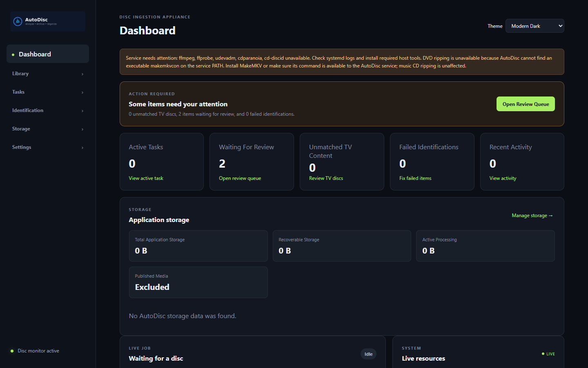

AutoDisc watches your optical drive, classifies what you insert (movie, TV series or audio CD), looks up metadata, rips and converts the content, and publishes it into the library layout you choose for **Jellyfin, Sonarr, Radarr, Lidarr or any custom folder structure**. When it is not sure, it never guesses. It asks you in the **Review Queue**.

Run it as a web dashboard for hands-on control, or as a headless Linux service for unattended ingestion.

---

## What's new in 2.0

AutoDisc 2.0 is the milestone release that brings together everything built since 1.0 and adds a brand-new presentation layer.

| | |
| --- | --- |
| 🎨 **Theme engine** | Four complete themes (Modern Light, Modern Dark, Windows 95 Classic and DOS Terminal) switchable from the top bar, with identical functionality in every one. |
| 🧩 **One review workflow** | Movies, TV and TV plans share a single `MediaReviewItem` model, queue, search-and-select flow and **Confirm & Continue** action. |
| 🔎 **First-class metadata** | Movies (TMDB), TV (TVDB, TMDB TV) and Music (MusicBrainz) are monitored side by side, with usage statistics and the reason any provider is disabled. |
| ⏱️ **Smarter MakeMKV discovery** | Inactivity and absolute timeouts, so large or copy-protected discs finish and hung processes do not run forever. |
| 📊 **Media-agnostic dashboard** | Media Identification and Provider Usage cards treat Movies, TV and Music equally. |
| 🛡️ **Hardened review completion** | Concurrent completions, title validation and candidate handling were fixed and covered by tests. |

> **Upgrading from 1.x?** Version 2.0.0 is a UI-only release over 1.37.0. There are no database migrations, API changes or settings changes. See [Upgrading](#upgrading).

---

## Contents

- [Quick install](#quick-install)
- [Features](#features)
- [Themes](#themes)
- [Screenshots](#screenshots)
- [How it works](#how-it-works)
- [Media support](#media-support)
- [Automation modes](#automation-modes)
- [Review Queue](#review-queue)
- [Metadata & Identification](#metadata--identification)
- [TV matching](#tv-matching)
- [Destination profiles](#destination-profiles)
- [Explainable classification](#explainable-classification)
- [Disc fingerprinting](#disc-fingerprinting)
- [Diagnostics & MakeMKV](#diagnostics--makemkv)
- [Configuration](#configuration)
- [Upgrading](#upgrading)
- [Running from source](#running-from-source)
- [Architecture](#architecture)
- [Documentation](#documentation)
- [Release history](#release-history)
- [Roadmap](#roadmap)
- [Contributing](#contributing)
- [Disclaimer](#disclaimer)

---

## Quick install

AutoDisc targets **Linux (Ubuntu, Debian, Lubuntu, Linux Mint)** and runs as a systemd service.

**1. Install**

```sh
sudo apt-get update && sudo apt-get install -y curl ca-certificates && \
  curl --fail --silent --show-error --location https://github.com/nick709r/DVDTOJELLYFIN/archive/refs/heads/main.tar.gz --output autodisc.tar.gz && \
  tar xzf autodisc.tar.gz && cd DVDTOJELLYFIN-main && sudo ./scripts/install.sh
```

The installer sets up Node.js 22, FFmpeg, cdparanoia, cd-discid and helper tools, builds AutoDisc and enables `autodisc.service`. It is safe to rerun for updates.

**2. Optional: enable DVD ripping.** Install [MakeMKV](https://www.makemkv.com/) (separately licensed, not bundled) so `makemkvcon` is on the service `PATH`. Audio CD ripping works without it.

**3. Open the dashboard** at `http://<server-ip>:8787`. If it is bound locally only, tunnel in:

```sh
ssh -L 8787:127.0.0.1:8787 user@server
```

**4. Create the administrator account** on first run. Disc processing stays disabled until you do.

**5. Choose where media goes.** In **Settings → Storage & Output**, create a destination profile and pick an automation mode.

**6. Insert a disc.** 🎬

```sh
sudo systemctl status autodisc.service     # is it running?
sudo journalctl -u autodisc.service -f      # live logs
```

> ⚠️ Do not expose the dashboard port to the internet. Put it behind a VPN or an authenticating reverse proxy.

**Permissions.** The installer configures library roots for group inheritance and adds AutoDisc to their groups. AutoDisc publishes directories as `775` and files as `664` and never enables world-write. For a custom destination, add the `autodisc` service account to that library's group and restart the service.

---

## Features

**Ingestion**
- Automatic disc detection from udev events, with presence checks and retry/backoff for slow drives
- DVD movies, DVD TV series and audio CDs, each with its own workflow
- DVD ripping through MakeMKV, conversion through FFmpeg with hardware-encoder detection and software fallback
- Lossless **FLAC** ripping for audio CDs with tagging

**Identification**
- Explainable classification with per-criterion evidence
- Metadata from **TMDB, TVDB, IMDb (via TMDB) and MusicBrainz** with caching, fallback and health-aware failover
- Disc fingerprinting that remembers what it has already seen
- Media-type overrides (Movie, TV Series, Music, Data Disc) with an audit trail

**Review**
- One unified Review Queue for movies, TV discs, TV plans, music and failures
- Search-and-select with ranked candidates, refine-search and manual-title fallback
- TV Disc Review with video previews, searchable episode selectors and partial saves
- Append-only audit trail with text and JSON export

**Publishing**
- Destination profiles for Jellyfin, Sonarr, Radarr, Lidarr and custom layouts
- Safe naming templates, NFO files and artwork
- Output previews before anything is written
- Storage Manager with safe cleanup and recovery estimates

**Operations**
- Regular Auto, Full Auto and Review-Based automation modes
- Live dashboard, streamed job timeline and disc diagnostics
- One-click update check and in-place updater
- **Four themes** for the whole interface

---

## Themes

Pick a theme from the **Theme** menu in the top bar, in the spot where Light/Dark used to be. Your choice is remembered per browser.

| Theme | Look |
| --- | --- |
| **Modern Light** | Clean, bright cards with a lime accent |
| **Modern Dark** (default) | The original AutoDisc look, tuned for low light |
| **Windows 95 Classic** | Grey bevelled panels, navy title bars, teal desktop |
| **DOS Terminal** | Black screen, monospace type, double-line borders, `[ buttons ]` |

Themes change **presentation only**: colours, borders, fonts, spacing, glyphs and chrome layout. Behaviour, workflows, APIs, state and settings are identical in every theme, and a parity test checks every element, form field and page against the 1.37.0 interface. See [docs/THEMES.md](./docs/THEMES.md) to add your own.

| Windows 95 Classic | DOS Terminal |
| --- | --- |
| 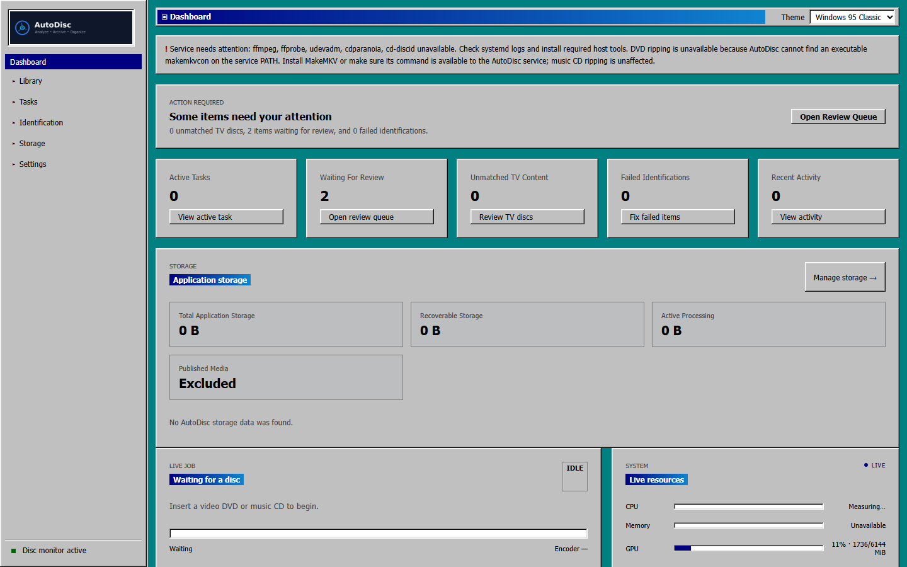 | 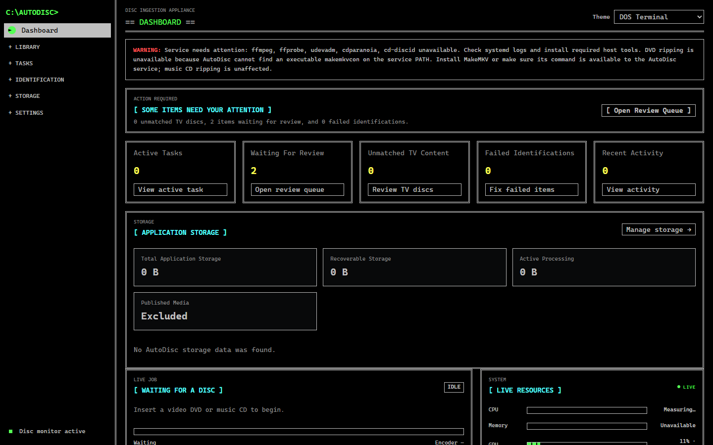 |

---

## Screenshots

| Area | Preview |
| --- | --- |
| Dashboard (Modern Dark) |  |
| Dashboard (Modern Light) | 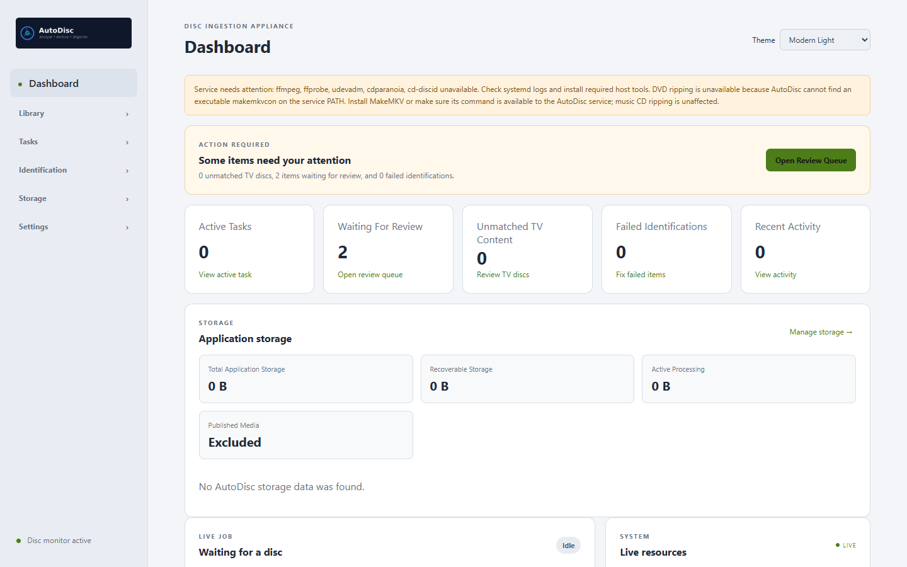 |
| Unified Review Queue | 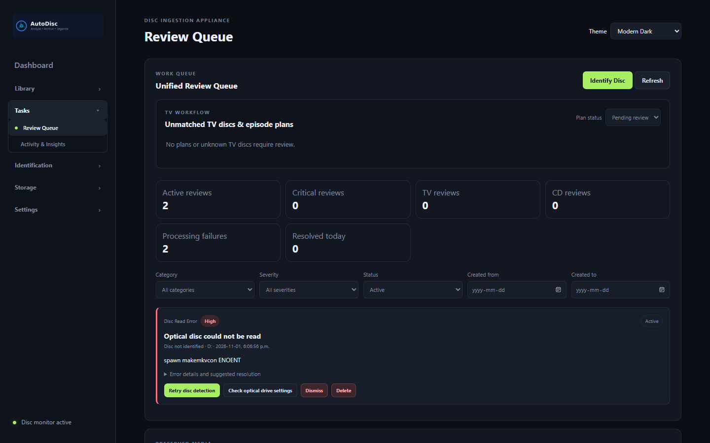 |
| Metadata & Identification | 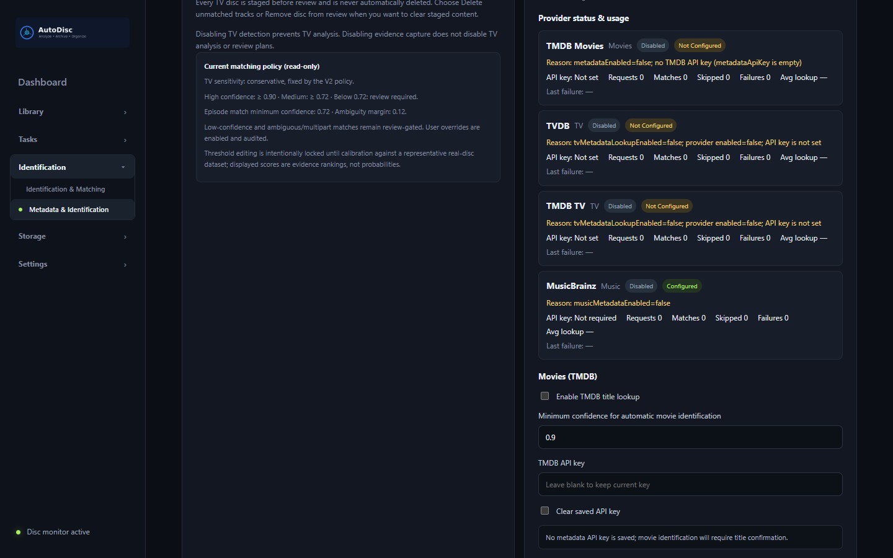 |
| Identification & Matching | 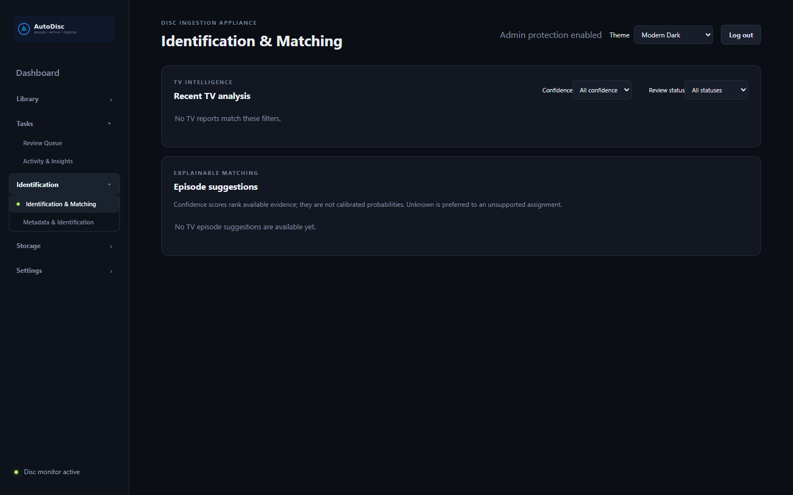 |
| Activity & Insights | 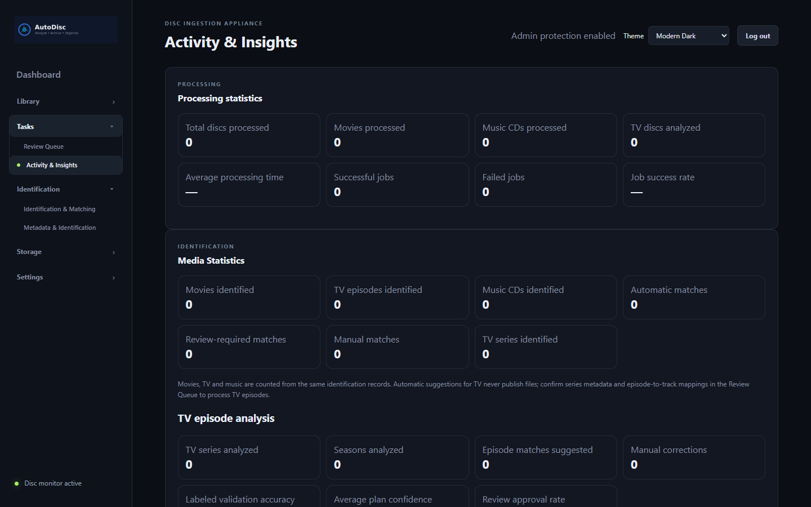 |
| Settings | 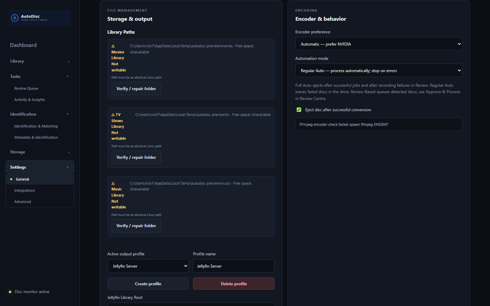 |

**The same screens in the retro themes**

| Review Queue, Windows 95 | Review Queue, DOS |
| --- | --- |
| 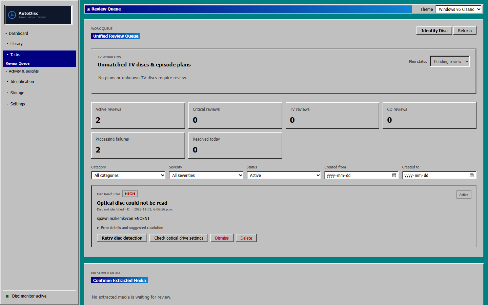 | 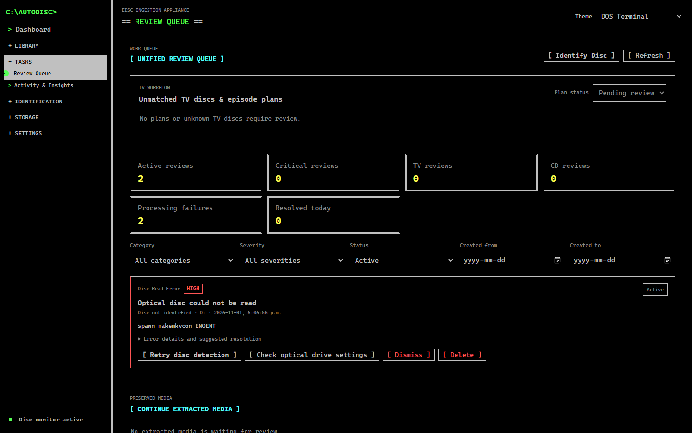 |
| **Settings, Windows 95** | **Settings, DOS** |
| 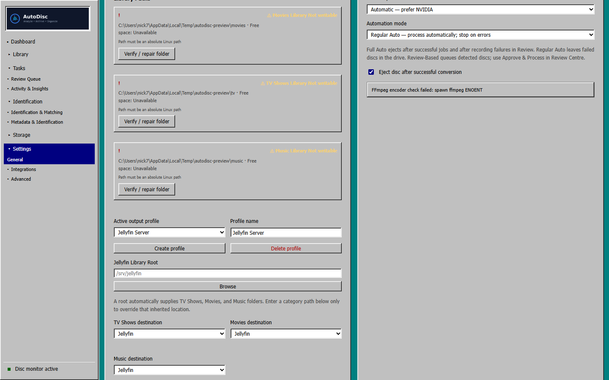 | 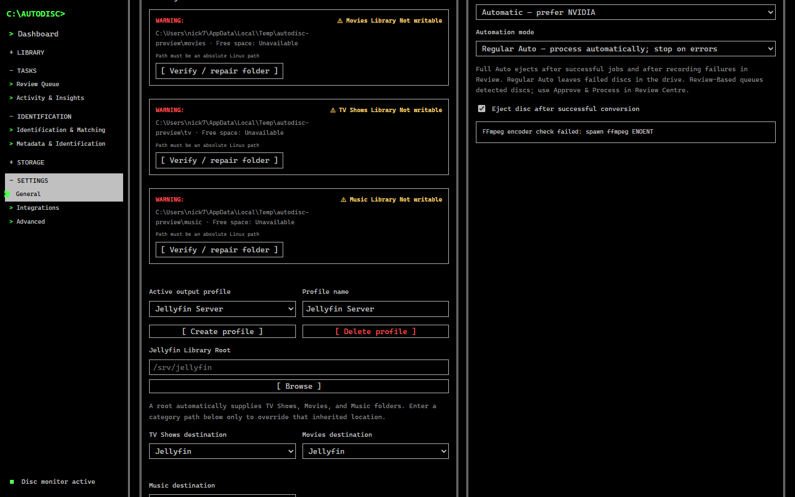 |

---

## How it works

```text
 Disc inserted
      │
      ▼
 ┌───────────┐   ┌──────────┐   ┌────────────────┐   ┌──────────┐
 │ Detection │──▶│ Analysis │──▶│ Classification │──▶│ Metadata │
 └───────────┘   └──────────┘   └────────────────┘   └────┬─────┘
                                                          │
                                       confident?         ▼
                                   ┌─────── yes ───┐  ┌────────┐
                                   │               │  │ Review │◀── no / failure
                                   ▼               │  │ Queue  │
                             ┌────────────┐        │  └───┬────┘
                             │ Processing │◀───────┴──────┘  (approved / corrected)
                             └─────┬──────┘
                                   ▼
                             ┌────────────┐
                             │ Publishing │──▶ Movies / TV / Music destinations
                             └────────────┘
```

1. **Detection**: the drive reports media and AutoDisc inspects it.
2. **Analysis**: titles, runtimes, track structure and disc labels are gathered.
3. **Classification**: movie, TV series or music, with a confidence score.
4. **Metadata**: providers supply titles, years, series, episodes, albums and artwork.
5. **Review, if needed**: uncertain, conflicting or failed results go to the Review Queue. Unidentified TV discs keep ripping into protected staging.
6. **Processing**: ripping, encoding or extraction.
7. **Publishing**: finished media lands in the destination profile's folder structure.

---

## Media support

### Movies

- Detects video DVDs and finds the main feature.
- Ripped with MakeMKV and converted with FFmpeg.
- The filesystem volume name is normalised (for example `SHREK_THE_THIRD`) and used for the TMDB search and as the fallback title.
- Uncertain matches are held for candidate review; a generated title never publishes without confirmation.
- Output such as `Movies/Title (Year)/Title (Year).mkv`, adjustable per profile.

### TV series

- Episodic detection and runtime analysis separate episodes from extras.
- Every TV disc is fully ripped into protected staging before review, and suggestions never publish on their own.
- Search by title or by TVDB, TMDB or IMDb ID, assign series and season, preview tracks and map episodes.
- Partial matches are saved; fully matched discs resume publishing automatically.
- Confirmed disc-to-series and track-to-episode mappings are stored against the disc fingerprint.

### Music

- Audio CDs are ripped with cdparanoia into numbered, tagged FLAC.
- Optional MusicBrainz lookup supplies artist, album, year and track titles.
- With no match, the job pauses and asks for a release ID or manual metadata, then resumes.
- Output as `Music/Artist/Album` with collision-safe handling and optional Lidarr hand-off.

---

## Automation modes

| Mode | Behaviour | Good for |
| --- | --- | --- |
| **Regular Auto** (default) | Processes confident results and sends uncertain ones to the Review Queue. | Everyday use |
| **Full Auto** | Keeps going. Failures are recorded and the disc is ejected so the drive can continue. | Unattended stacks |
| **Review-Based** | Every disc waits for your approval before processing starts. | Careful curation |

---

## Review Queue

The Review Queue is where automation hands control back to you, and where nothing is silently lost. **Movies, TV and TV plans share one workflow and one `MediaReviewItem` model.**

1. A disc enters the queue.
2. AutoDisc searches the metadata providers.
3. Ranked results are shown with a confidence score.
4. You pick a result, or refine the search.
5. Manual title entry is available as a fallback only.
6. **Confirm & Continue** resumes processing.

It also collects failed jobs, unknown media, metadata conflicts and classification overrides, with recovery actions such as retry, set provider IDs, map tracks, enter metadata and fix folders. Every correction records the administrator and time, and the original detection is never overwritten.

Completion is safe: concurrent requests for the same item are serialised, a title or selected candidate is required before a movie resumes, whitespace titles fall back to the selected candidate, and an unknown candidate id is reported rather than ignored. Details in [Unified media review](./docs/UNIFIED-REVIEW.md).

---

## Metadata & Identification

**Settings → Metadata & Identification** is the single home for lookups:

- **Provider list** for TMDB Movies, TMDB TV, TVDB and MusicBrainz, showing Enabled/Disabled, Configured/Not configured, API-key status, media type, request, match, skip and failure counts and the last failure.
- **Reasons, not guesses.** A disabled provider says why, for example `Reason: metadataEnabled=false`.
- **API keys, timeouts and confidence thresholds** for movies, TV and music in one place.
- **Provider usage** with requests, successful matches, failures and average lookup time per provider.

The dashboard's **Media Identification** card counts movies, TV episodes and music CDs identified, plus automatic, review-required and manual matches. Every lookup is logged with media type, provider, query, result count, selected result and failure reason.

> **Good to know:** movie lookup is off by default (`metadataEnabled=false`). With it off, a movie such as `SHREK_THE_THIRD` is routed to review and keeps its disc label until you enable TMDB and add an API key, or confirm a title. Settings now show this reason directly.

Read-only APIs: `GET /api/v1/metadata/usage` and `GET /api/v1/identification/stats`. See [TV metadata settings](./docs/TV-METADATA-SETTINGS.md).

---

## TV matching

- **TV Disc Review** shows series and season information, artwork, confidence, episode counts and searchable selectors, with a short video clip, thumbnail strip, runtime and resolution per track.
- **Provider DVD order** (including TVDB disc ordering) assigns tracks when the series, season and disc are confident; otherwise AutoDisc falls back to sequential ordering after excluding extras and duplicates.
- **Disc-label hints** such as `S03D02` are parsed as evidence, weighed against previously completed discs.
- **Continuity evidence** uses already-imported episodes to propose the next missing ones.
- **Staging safety**: staged content is never auto-deleted and never needs re-ripping.

**Storage paths.** Settings → Storage & Output shows the work, TV staging, review and cache directories and checks them for overlap with library paths. Leave the TV Staging Directory blank for the default `<work>/tv-staging/unidentified`, or set `TV_STAGING_DIR`.

---

## Destination profiles

- Multiple named profiles, one active at a time
- Separate routes for movies, TV and music
- Jellyfin, Sonarr, Radarr, Lidarr and custom folder structures
- Category overrides and output previews before writing

See [Output Destination Profiles](./docs/OUTPUT-DESTINATION-PROFILES.md).

---

## Explainable classification

```text
Classification: TV Series          Confidence: 87%
  ✔ 4–6 titles of similar runtime (41–44 min)
  ✔ Runtime variance within episode tolerance
  ✔ Disc label matches a series pattern ("SHOW_S02_D1")
  ✔ No single dominant feature-length title
  ✖ Series not yet confirmed by metadata   → sent to Review
```

*Illustrative output; exact criteria vary by release.* Low confidence never turns into a silent guess.

---

## Disc fingerprinting

Each disc gets a signature derived from its structure, used to recognise repeats, reuse your earlier overrides and mappings, support multi-disc sets and give each physical disc a stable identity.

---

## Diagnostics & MakeMKV

- **Activity & Insights** shows detection, classification reasoning, metadata attempts, a streamed event timeline and failure analysis.
- **MakeMKV discovery** uses two limits so slow discs finish and hung processes end:
  - `makemkvDiscoveryTimeoutMs` (default `300000`): inactivity timeout, reset by any output.
  - `makemkvDiscoveryAbsoluteTimeoutMs` (default `900000`): hard ceiling regardless of output.
  - Logs under `component: makemkv` record start, completion and whether a kill was due to inactivity or the absolute limit.

---

## Configuration

Set these as environment variables (for the service, in `/etc/default/autodisc`).

| Variable | Purpose | Default |
| --- | --- | --- |
| `PORT` / `HOST` | Dashboard listen port and address | `8787` / `0.0.0.0` |
| `DATABASE_PATH` | SQLite database | `/var/lib/autodisc/autodisc.sqlite` |
| `WORK_DIR` | Work, review and cache area | `/var/cache/autodisc` |
| `MOVIES_DIR` / `TV_DIR` / `MUSIC_DIR` | Library roots | `/srv/jellyfin/...` |
| `TV_STAGING_DIR` | Optional TV staging location | `<work>/tv-staging/unidentified` |
| `OPTICAL_DEVICE` | Optical drive | `/dev/sr0` |
| `LOG_LEVEL` | Logging verbosity | `info` |

Metadata keys, thresholds and timeouts are configured in the UI under **Settings**.

---

## Upgrading

- Use **Settings → AutoDisc updates → Check for updates**, or rerun the installer.
- 2.0.0 contains **no database migrations, API changes or settings changes** compared with 1.37.0. Rolling back to 1.37.0 is safe.
- The previous Light/Dark preference is migrated to Modern Light/Dark automatically.
- Statistics for the Provider Usage card begin accumulating after upgrading to 1.36.1 or later.

---

## Running from source

For development or evaluation (Node.js 22 or newer):

```sh
npm ci
npm run build
npm test
npm start          # serves the dashboard on http://localhost:8787
```

`better-sqlite3` is a native module. If no prebuilt binary matches your platform you need a C/C++ toolchain (build-essential on Linux, Visual Studio Build Tools on Windows). Disc reading and ripping require Linux with the tools listed in the installer.

---

## Architecture

```text
┌──────────────────────────────────────────────────────────┐
│               Frontend (web dashboard + themes)          │
│  Dashboard · Review Queue · Metadata · Diagnostics       │
└───────────────────────────┬──────────────────────────────┘
                            │ API + live events
┌───────────────────────────▼──────────────────────────────┐
│                 Backend (job coordinator)                │
│       SQLite storage · auth · settings · history         │
├───────────┬────────────────┬──────────┬────────┬─────────┤
│ Detection │ Classification │ Metadata │ Review │ Publish │
└───────────┴────────────────┴──────────┴────────┴─────────┘
        MakeMKV · FFmpeg · cdparanoia · udev (external tools)
```

TypeScript on Fastify and SQLite for the backend; a dependency-free vanilla JavaScript front end. Media-specific behaviour lives in adapters behind the shared review and metadata services, so new media types and providers plug into the same pipeline. See [Version 2 architecture](./docs/V2-ARCHITECTURE.md).

---

## Documentation

- [Themes](./docs/THEMES.md)
- [Unified media review](./docs/UNIFIED-REVIEW.md)
- [Output destination profiles](./docs/OUTPUT-DESTINATION-PROFILES.md)
- [Library metadata & organisation](./docs/METADATA-LIBRARY-ORGANIZATION.md)
- [TV metadata settings](./docs/TV-METADATA-SETTINGS.md)
- [TV workflow integration](./docs/TV-WORKFLOW-INTEGRATION.md)
- [TV manual recovery](./docs/TV-MANUAL-RECOVERY.md)
- [Disc diagnostics](./docs/DISC-DIAGNOSTICS.md)
- [Storage lifecycle](./docs/STORAGE-LIFECYCLE.md)
- [Version 2 architecture](./docs/V2-ARCHITECTURE.md)
- [Roadmap](./docs/ROADMAP.md)

---

## Release history

Highlights. The complete per-version log is in [docs/RELEASE-HISTORY.md](./docs/RELEASE-HISTORY.md).

### Version 2.0.0

- Added the theme engine and a theme picker in the top bar: Modern Light, Modern Dark, Windows 95 Classic and DOS Terminal. The choice is stored per browser and earlier Light/Dark preferences migrate automatically.
- Themes change presentation only. Behaviour, workflows, APIs, the database, the settings schema, ripping, metadata and review logic are identical in every theme.
- Functional parity with 1.37.0 is enforced by `test/themes.test.js` against `test/fixtures/v1.37.0-ui-hooks.json`.
- Rewrote the README with a quick install guide and screenshots; the full change log moved to [docs/RELEASE-HISTORY.md](./docs/RELEASE-HISTORY.md).

Earlier releases:

| Version | Highlights |
| --- | --- |
| 2.0.0 (above) | Theme engine: Modern Light, Modern Dark, Windows 95 Classic, DOS Terminal. UI-only, parity-tested against 1.37.0. |
| 1.37.0 | Movie, TV and Music metadata providers are first-class in Settings, with disabled reasons and skip counts. |
| 1.36.x | Media-agnostic dashboard and settings; Media Identification and Provider Usage cards; absolute MakeMKV timeout. |
| 1.35.0 | Configurable, inactivity-based MakeMKV discovery timeout with `makemkv` logging. |
| 1.34.x | Unified `MediaReviewItem` queue and single completion endpoint; concurrency and validation fixes. |
| 1.33.0 | Consistent volume-name movie lookup and explicit title confirmation. |
| 1.28–1.32 | Structured TV matching evidence, disc continuity and structure-evidence gating. |
| 1.27.0 | Standardised published-media permissions. |
| 1.20–1.24 | TV Disc Review redesign, provider DVD ordering, Storage Manager, drive diagnostics and updater fixes. |

---

## Roadmap

**Near-term**: improved TV identification validated on real discs, enhanced metadata, Blu-ray support, expanded review workflows.

**Long-term**: Archivist Mode, collection management, multi-drive scheduling, preservation workflows.

Roadmap items are goals, not commitments. See [docs/ROADMAP.md](./docs/ROADMAP.md).

---

## Contributing

Issues and pull requests are welcome. Run `npm test` before submitting. UI changes must keep every element in `test/fixtures/v1.37.0-ui-hooks.json` working in all themes.

---

## Disclaimer

AutoDisc is a tool for organising media you own. Use it only in accordance with the laws of your country and the terms of the software it works with. AutoDisc does not bundle MakeMKV or any decryption software and is not affiliated with Jellyfin, Sonarr, Radarr, Lidarr, TMDB, TheTVDB or MusicBrainz.
