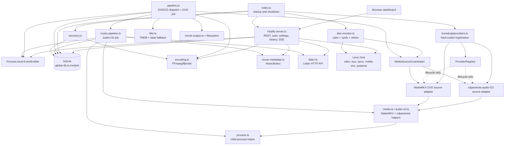

# AutoDisc Current Architecture Review

**Review date:** 2026-10-19
**Reviewed branch:** `roadmap/v2-planning`
**Reviewed commit:** `d5def18` (`feat: route disc workflows through v2 source providers`)
**Scope:** Static review of the TypeScript application, source-provider migration,
current platform integrations, and v2 architecture documents. This report changes
no application code. It describes the repository at the reviewed commit; the
target diagram is an architectural destination, not a statement of implemented
functionality.

## Executive assessment

AutoDisc is a single-process, single-node Linux application. It currently
combines the HTTP API, disc monitor, job orchestration, SQLite persistence,
media extraction, FFmpeg conversion, metadata lookup, publication, recovery,
and resource sampling in one Node.js process. SQLite is the durable source of
job history and settings; process-local event emitters and maps coordinate live
status and cancellation.

The v2 branch has established useful initial seams:

- A provider contract and lifecycle registry.
- Two registered source adapters: MakeMKV DVD and cdparanoia audio CD.
- A `MediaSourceCoordinator` used by the actual disc monitor and pipelines for
  source inspection and acquisition.
- Contract and coordinator tests.

This is a **partial ports-and-adapters migration**, not yet a provider platform.
The registry is populated manually in bootstrap; its health results are not
used for orchestration or surfaced through the API. The source contract and
pipeline still encode DVD/audio-CD variants. Metadata, transformation,
publication, persistence, drive monitoring, notifications, and platform
services remain concrete v1 implementations. New source kinds would still
require changes to core unions and orchestration.

The highest-risk architectural issue is the concentration of responsibilities
and concrete dependencies in `server.ts`, `pipeline.ts`, `music-pipeline.ts`,
`db.ts`, and `disc-monitor.ts`. The best migration sequence is to stabilize
provider-neutral domain types and dependency injection, separate persistence
behind repositories, centralize job orchestration and durable events, and then
migrate metadata, transforms, libraries, drives/platforms, and queue expansion.

## 1. Current architecture diagram

Solid connections indicate direct calls or imports. Dotted registry connections
represent lifecycle ownership; the source coordinator receives the concrete
source instances from bootstrap and calls them directly. The diagram omits
small helpers (logging, title sanitization, job-control, updater, and shared
types) for legibility.

### Runtime request and job paths

**DVD:** startup constructs the registry and two source providers; the disc
monitor schedules an inspection; the coordinator tries audio-CD inspection
first, then MakeMKV DVD inspection; `pipeline.ts` chooses the longest DVD
title, persists and updates the job, calls the selected provider to rip, then
resolves a title, converts with FFmpeg, publishes to the configured Movies
folder, cleans work files, records completion, and optionally ejects.

**Audio CD:** the same monitor/coordinator tries the cdparanoia source first.
When it recognizes tracks, `pipeline.ts` calls `processAudioCd` with an
acquisition callback. `music-pipeline.ts` then owns job persistence, track
extraction, MusicBrainz/manual metadata behavior, FLAC encoding, filesystem
publication or Lidarr handoff, cleanup, completion, and optional eject.

**Dashboard:** Fastify routes in `server.ts` call the database module directly
for settings, jobs, history, and stats. The same module also directly calls
concrete encoder, executable, process, metrics, Lidarr, metadata, and updater
modules. Server-Sent Events use the process-local `EventEmitter`; live resource
sampling is separately activated while a metrics SSE subscriber exists.

## 2. Existing providers and integrations

“Provider” below means an implementation registered with the new provider
registry. Concrete integrations that have no such registration are labeled
legacy/direct integrations to avoid overstating migration progress.

| Provider or integration | Current implementation | Registry state | Notes |
|---|---|---|---|
| DVD source / MakeMKV | `MakeMkvDvdSourceProvider` | Registered | Inspects one configured device and acquires a selected title. Wraps functions in `media.ts`. |
| Audio-CD source / cdparanoia | `CdParanoiaSourceProvider` | Registered | Inspects one configured device and acquires tracks. Wraps functions in `audio-cd.ts`. |
| TMDB movie title lookup | `title.ts` | Not registered | Direct `fetch`; configured through global `AppSettings`; label fallback is inside the same function. |
| MusicBrainz audio metadata/disc ID | `music-metadata.ts`, `musicbrainz-discid.ts` | Not registered | Direct HTTP lookup and cd-discid-derived identity; not exposed as a metadata-provider selection system. |
| Lidarr import | `lidarr.ts` | Not registered | Direct HTTP client called from the music pipeline and API. |
| FFmpeg/ffprobe encoding | `encoding.ts`, `music-pipeline.ts` | Not registered | DVD conversion helper and separate hard-coded FLAC command path. Encoder selection is a concrete policy. |
| Filesystem output/publication | `movie-output.ts`, pipelines | Not registered | Direct filesystem staging, hard links/renames, paths, cleanup, and destination policy. |
| Optical drive monitoring/ejection | `disc-monitor.ts`, `media.ts` | Not registered as a drive provider | Linux udev/sysfs monitoring is outside the provider registry; eject is a concrete command helper. |
| Notifications | None | Not present | Status SSE and job events are not an outbound notification-provider system. |
| Platform, storage, telemetry, library, transform providers | None | Not present | These kinds are permitted by the generic `ProviderKind` union, but there are no implementations registered. |

The provider registry currently provides lifecycle methods and a descriptor
with ID, API version, kind, and capability names. It does not yet have provider
configuration schemas, dependency declarations, dynamic discovery, or
capability-based workflow selection. Bootstrap explicitly constructs the two
source instances and separately passes the same list to
`MediaSourceCoordinator`.

`healthCheckAll()` exists but is not called by startup, the API, or the source
coordinator. Both source adapters currently return a runtime availability
result based on executable presence; actual inspection still runs through
legacy helpers. Registration therefore does not yet govern feature health,
availability, configuration, or selection.

## 3. Existing services and direct service dependencies

| Service/module | Main responsibilities | Direct dependencies / coupling |
|---|---|---|
| `index.ts` | Process startup, recovery, server/monitor lifecycle, shutdown | Global DB, logger, recovery, server, monitor, provider bootstrap. Starts providers before configuration/recovery and closes them at shutdown. |
| `bootstrap/providers.ts` | Construct/register built-in source providers and coordinator | Concrete DVD/CD provider classes, logger, registry. Registrations are explicit and hard-coded. |
| `ProviderRegistry` | Descriptor validation, lifecycle, health calls, reverse disposal | Generic provider interface only; currently no dependency graph or external runtime registration. |
| `MediaSourceCoordinator` | Probe source providers in configured order; route acquisition | Concrete ordered provider list; returns provider instance plus a closed-union candidate. |
| `disc-monitor.ts` | udev subscription/reconnect, sysfs polling, retry/backoff, duplicate state | Direct DB settings/job/fingerprint operations, global events, pipeline, runtime status, logger, Node spawn, `/sys/class/block`. |
| `pipeline.ts` | Disc job admission, DVD selection and workflow, audio-CD dispatch | Global DB functions, coordinator, encoding, title resolver, output helper, music pipeline, updater state, runtime status, job-control, global events and logger. |
| `music-pipeline.ts` | Full audio-CD job lifecycle and output | Global DB, events, logger, MusicBrainz resolver, process-local manual prompt map, Lidarr HTTP service, child-process helper, filesystem, eject, runtime status, job-control. Reads global settings and environment-derived FFmpeg command. |
| `server.ts` | Fastify app, auth, REST, settings validation, history/stats, provider/tool checks, SSE, metrics | Global DB and raw SQL, event emitter, job control, encoding, executable/process helpers, metrics sampler, runtime status, logger, Lidarr, manual metadata, MusicBrainz, updater, Linux `/proc`/NVIDIA commands. |
| `db.ts` | SQLite initialization, migrations, settings/jobs/events queries, active-job constraint | Global singleton `better-sqlite3`, process environment, filesystem directory creation, domain model. Acts simultaneously as connection, migrations, settings store, job repository, history repository, and event writer. |
| `encoding.ts` | FFmpeg inventory, NVENC probing, H.264 conversion, validation, progress and atomic output | Global process environment, child-process helper, logger, concrete settings model, direct filesystem operations. |
| `audio-cd.ts` | cdparanoia TOC parsing, cd-discid identity, audio extraction | Global command environment, process helper, logger, filesystem, MusicBrainz-discid helper. Used by the registered source provider and legacy metadata typing. |
| `media.ts` | MakeMKV info parsing/ripping, eject, title sanitization | Global MakeMKV/eject command environment, process helper, filesystem, model title type. Used by the DVD source adapter and other workflow helpers. |
| `title.ts` | TMDB movie title lookup and fallback | Concrete TMDB URL/API shape, `fetch`, global settings, logger. |
| `music-metadata.ts` | MusicBrainz release resolution/parsing | Concrete MusicBrainz API, global `fetch`, audio source model, logger. |
| `lidarr.ts` | Lidarr URL validation, connection test, import command/polling | Concrete Lidarr API shapes and endpoints, global `fetch`, timers. |
| `manual-music-metadata.ts` | Pending metadata prompts and promise resolution | Process-global map, `EventEmitter`, audio-disc and metadata concrete types. Not persisted across restart. |
| `recovery.ts` | Remove abandoned temp outputs and recover completed publication | Direct DB functions, FFprobe helper, settings paths, direct filesystem layout and naming patterns. |
| `metrics-sampler.ts` | On-demand interval sampler with subscriber lifecycle | Generic collector callbacks; reasonably isolated and unit tested. Collector is wired in `server.ts`. |
| `runtime-status.ts` / `job-control.ts` | Process-local status, cancellation, one active operation state | Global mutable state and event emitter; cancellation state is not a persisted queue/worker lease. |
| `process.ts` | Child process execution, timeout and cancellation | Node child_process and environment; broadly reused concrete infrastructure helper. |

### Important direct-dependency observations

- `disc-monitor.ts` directly imports `pipeline.ts`, so device-event
  orchestration is coupled to the entire job implementation instead of an
  application-level command interface.
- Both job pipelines independently own durable status updates, event
  publication, cleanup, failure/cancellation interpretation, and final
  completion/eject behavior.
- `server.ts` is not a thin transport adapter. It queries and mutates
  persistence directly, constructs integration requests, owns validation and
  operational checks, and implements Linux resource collection.
- `MediaSourceProvider` imports `AudioTrackFile` from the legacy
  `audio-cd.ts`; the provider contract is therefore not yet independent of the
  legacy implementation module.
- Job, settings, status, source candidate, and encoder types are defined as
  closed application-specific structures. Several core workflow branches
  switch explicitly on `"dvd"` and `"audio_cd"`.

## 4. Legacy v1 components still in use

The following are production-path components, not dead code:

1. **Monolithic pipelines:** `pipeline.ts` remains the workflow coordinator and
   DVD implementation; `music-pipeline.ts` remains an independent full
   audio-CD workflow.
2. **Legacy media/tool adapters:** `media.ts`, `audio-cd.ts`, `encoding.ts`,
   `process.ts`, and `title.ts` still contain concrete MakeMKV, cdparanoia,
   FFmpeg, TMDB, eject, filesystem, and process behavior. New source providers
   delegate to these modules rather than owning independent adapter
   abstractions.
3. **Global database module:** `db.ts` owns connection creation, DDL,
   migrations, settings, job state transitions, event records, recovery
   queries, history, and statistics. Callers import its functions/singleton.
4. **Concrete HTTP server:** `server.ts` implements route handlers and
   application/domain decisions in the same module, including settings
   validation, SQL queries, integration checks, cancellation, and metrics.
5. **Linux device/platform implementation:** udev monitoring, sysfs media
   size, `/proc` telemetry, `nvidia-smi`, Linux path validation, and systemd
   update helpers are direct dependencies.
6. **In-process event and operational state:** `events.ts`,
   `runtime-status.ts`, `job-control.ts`, and manual metadata prompt maps use
   process memory. They support the current single-process model but do not
   provide durable event delivery or queue leases.
7. **Fixed settings contract:** `AppSettings` is a single fixed schema. TMDB,
   MusicBrainz, Lidarr, output paths, encoder options, and service credentials
   are not provider-namespaced.
8. **Current updater/deployment contract:** update handling assumes tagged
   GitHub releases and systemd path/service helpers; this is not an OS-neutral
   platform provider.

## 5. Areas tightly coupled today

### Critical: ingestion type is encoded in orchestration

`MediaSourceCandidate` and `AcquiredSource` are discriminated unions for DVD
and audio CD. `pipeline.ts` branches on those variants, picks a DVD main title,
constructs the audio-domain shape for `processAudioCd`, and applies different
downstream flows. Adding watch-folder video or Blu-ray would require changes to
these unions and the pipeline rather than only adding a provider.

### Critical: job use cases own infrastructure

Both pipelines import DB functions, global settings, events, filesystem APIs,
process helpers, status globals, cancellation globals, concrete providers, and
publication logic. This makes integration tests and alternate implementations
harder to substitute and risks duplicated lifecycle semantics between media
types.

### High: provider registration is a façade, not the composition boundary

Only two built-in source providers are registered. Bootstrap hard-codes them;
the registry’s list is not the source coordinator’s authoritative input (the
same list is separately maintained), and other provider kinds are unused.
Capabilities are descriptive strings only. No planner filters providers by
capability, configuration, health, or source type.

### High: external integrations are imported directly

TMDB, MusicBrainz, and Lidarr logic is called by workflows or API handlers.
Provider-specific settings and validation live in `AppSettings` and
`server.ts`. A second metadata source or media-library integration would
currently require edits to existing core modules.

### High: persistence and event delivery are not replaceable

SQLite is a global singleton, and callers use its functions/raw statements.
`EventEmitter` notifications are process-local and mostly just trigger UI
updates. Durable `job_events` records are not a transactional outbox consumed
by subscribers; several state changes and status events are performed as
separate operations.

### High: platform assumptions are cross-cutting

The monitor knows Linux device paths and `/sys`; the API knows `/proc`,
`nvidia-smi`, `/dev`, and Linux absolute-path rules; update plumbing is
systemd-specific. These assumptions prevent Windows/macOS support from being
implemented only as platform adapters.

### Medium: one source ID is treated as the one configured optical device

Discovery is not a source-provider stream or a drive registry. The configured
`opticalDevice` is read from global settings; the monitor watches its
udev-specific events and passes its path to the coordinator. There is no
stable cross-platform drive identity, per-drive lifecycle, or resource claim.

### Medium: domain, application, and transport models are conflated

`AppSettings`, `Job`, `DiscTitle`, and audio-CD structures serve persistence,
workflow, and API boundaries. Contract versioning exists for provider
descriptors, but API schemas, events, job-step schemas, and persisted provider
configuration have no equivalent versioned boundary.

### Medium: observable extension health is incomplete

Registry health methods exist but are not run or exposed. The existing
`/api/health` uses a separate hard-coded tool list and treats `udevadm` as a
required dependency. Provider health and readiness may therefore diverge.

## 6. Areas already migrated to v2

| Area | Implemented now | Remaining limitation |
|---|---|---|
| Provider base contract | ID, semver-like API version, kind, capability list, initialize, health, dispose | No runtime config schema, dependency metadata, structured error contract, or provider-specific context beyond logger. |
| Provider registry | Validates IDs/version/kind/capabilities, rejects duplicates, initializes in order, disposes in reverse, preserves cleanup failures | Registration is manual; startup failure of any provider is global; no optional/required distinction, capability resolution, or dependency ordering. |
| Source provider contract | Inspection and acquisition calls with source candidates and typed results | Candidate/result unions hard-code current media kinds; source discovery and platform drive services are absent. |
| DVD/audio-CD source adapters | MakeMKV and cdparanoia implementations registered at startup | They wrap v1 helpers; provider health is not used by coordinator; both use process environment and concrete device strings. |
| Source coordinator | Probes providers in order and dispatches acquisition to the recognizing provider | Fixed sequential probing and selected provider object; no capability-based selection, multiple candidates, planning, or persisted provider choice. |
| Production wiring | Monitor and pipelines receive coordinator; registry lifecycle integrated into process startup/shutdown | The rest of the job workflow bypasses providers and uses legacy services directly. |
| Tests | Registry validation/lifecycle/failure, coordinator selection/acquisition/identity, production registration | No monitor/pipeline integration tests against fake providers; no real drive or Linux service acceptance from this Windows review environment. |
| Architecture documentation | Target platform design, roadmap gates, and this current-state report | The target contracts and diagrams still need to be reconciled as implementation evolves. |

## 7. Migration progress report

At the reviewed commit, the v2 migration is at the beginning of **Gate A**.

| Capability | Progress | Evidence / status |
|---|---:|---|
| Target architecture and staged gates | Designed | `docs/V2-ARCHITECTURE.md` and `docs/ROADMAP.md`. |
| Provider contract and registry | Started | Implemented and contract-tested. |
| Source-provider seam | Partially migrated | DVD/CD inspection and acquisition use the coordinator in production. |
| Domain isolation | Not started | Provider contract imports legacy `audio-cd.ts`; media kinds and job types are closed unions. |
| Composition-root DI | Partial | Provider construction is centralized, but other services remain module globals and hard-coded imports. |
| Persistence ports/repositories | Not started | `db.ts` singleton and direct imports/raw SQL remain. |
| Durable event/outbox | Not started | EventEmitter and `job_events` table remain separate mechanisms. |
| Workflow planner/job-step engine | Not started | Two media-specific pipelines still own their workflows. |
| Metadata providers | Not started | TMDB/MusicBrainz remain direct implementations. |
| Transform providers | Not started | FFmpeg conversion and FLAC commands remain direct. |
| Library providers | Not started | Filesystem publication and Lidarr integration remain embedded in pipelines. |
| Drive/platform providers | Not started | Linux udev/sysfs/device-path assumptions remain direct. |
| Notification providers | Not started | No outbound provider implementation. |
| Multi-drive / advanced queue | Not started | Single configured device and one active job constraint. |
| Cross-platform support | Not started | Linux implementation and deployment remain assumed. |
| API/provider schema discovery | Not started | Server/UI settings are fixed and concrete. |

**Overall:** foundational contracts and the first production source seam are
present. The product remains operationally and structurally a v1 application
with a limited v2 layer; it is not yet extensible to the requested future
feature set without additional core changes.

## 8. Recommended migration order

The order below minimizes simultaneous behavioral change and makes each
boundary testable before moving the next dependency.

### 0. Freeze migration seams and compatibility contracts

- Decide provider ID, API version, capability naming, error/health semantics,
  configuration ownership, and shutdown rules.
- Remove legacy-module type imports from contracts; move normalized media,
  candidate, manifest, artifact, and result types into provider-neutral domain
  modules.
- Decide whether a source provides discovery, inspection, acquisition, or all
  three; represent multiple discovered candidates without adding a media-kind
  branch to the coordinator.
- Make the registry the single source of truth for registered implementations;
  register through typed factories rather than parallel hard-coded arrays.

**Gate:** a fake source with a new media kind can pass inspect/acquire through
the coordinator without editing coordinator/pipeline media-kind switches.

### 1. Establish the application composition root and ports

- Construct configuration, database/repositories, logger, event publisher,
  provider registry, use cases, API, and monitor through dependency injection.
- Replace module-level singleton access in services incrementally; keep a
  compatibility composition for current behavior during migration.
- Explicitly classify providers as required or optional; surface validation and
  health results and close partially initialized providers on every startup
  failure path.

**Gate:** application services can be instantiated with fakes in tests and do
not import concrete integrations or process globals.

### 2. Extract persistence repositories and migrations

- Separate connection/migrations from job, settings, history, event, and
  recovery repositories.
- Move API raw SQL behind query/use-case interfaces and validate persisted
  settings at load time.
- Preserve current SQLite schema/data using explicit migration tests against
  released v1 database copies.

**Gate:** API and pipeline tests can run against a repository fake or isolated
SQLite implementation, and v1 data upgrades without losing history/settings.

### 3. Centralize job coordination and durable events

- Extract job admission, status transition, cancellation, cleanup, and recovery
  from the DVD and music pipelines into shared use cases/step orchestration.
- Add idempotent job steps, typed failure classes, resource claims, and
  persisted selected-provider/version data.
- Add a transactional outbox or a documented atomic equivalent for state/event
  writes. Keep SSE as a transport subscriber to application events.
- Keep the current serial behavior and one-drive limits as defaults.

**Gate:** crash, duplicate-event, cancellation, partial-output, and recovery
tests prove there is no duplicate publish or success-shaped failure.

### 4. Migrate metadata, transform, and library behavior

- Wrap TMDB and MusicBrainz behind metadata-provider contracts and a resolver;
  keep manual metadata as a resolver outcome.
- Wrap FFmpeg DVD encoding and audio FLAC conversion as transform providers
  with declared inputs, outputs, resources, validation, and capability
  fallbacks.
- Extract generic filesystem publication and Lidarr/Jellyfin behaviors into
  library/import providers; do not put vendor rules in the coordinator.
- Move provider configuration/schema discovery and secret references out of
  the fixed `AppSettings`/route switch.

**Gate:** adding a second metadata or library implementation requires a new
provider and registration/configuration, not edits to job workflows or API
vendor branches.

### 5. Migrate drives and platform services

- Introduce stable drive identities, drive discovery/watch/state/eject
  contracts, and resource claims.
- Move udev, sysfs, `/proc`, `nvidia-smi`, Linux path checks, and systemd updater
  functions behind Linux adapters.
- Keep Linux as the first supported platform while adding host-independent
  fake tests; implement Windows/macOS only with platform CI and packaging.

**Gate:** domain/application modules do not import OS paths or commands; one
additional drive provider can be added without changing job orchestration.

### 6. Add queue expansion and remaining provider categories

- Add bounded worker concurrency, priorities, schedules, batches, retry policy,
  and fairness only after resource claims, durable jobs, and recovery are
  established.
- Add watch-folder/file-import, Blu-ray/UHD, notification, and further library
  providers through the same contracts.
- Add event-derived processing/storage/drive/user statistics and dynamic
  provider configuration UI; keep live telemetry demand-driven.

**Gate:** new feature acceptance criteria in the v2 architecture are met,
including bounded resources, visible failure, secret safety, migrations, and
contract tests.

## 9. Technical debt report

Severity describes architectural impact/risk to the v2 extensibility objective,
not a security vulnerability rating.

| Priority | Debt | Current impact | Recommended disposition |
|---|---|---|---|
| P0 | Closed media-kind unions and type-specific workflow branches | New source kinds require changes to core types and pipeline; fails the central extension criterion. | Normalize source candidate/manifest/artifact and make workflow steps capability-driven before adding formats. |
| P0 | Pipeline services combine orchestration with DB, filesystem, tools, integrations, and events | Hard to substitute providers, test failure paths, or share queue semantics across source types. | Extract use cases and job coordinator after stable domain contracts/repositories. |
| P0 | Provider registry is not authoritative for execution | Registry can report registered modules but coordinator wiring remains separately constructed; capability and health metadata do not drive selection. | Registry-backed typed resolution with runtime validation and required/optional provider policy. |
| P1 | Global SQLite singleton and raw SQL in API | Persistence schema leaks into HTTP; tests and future storage changes require broad edits. | Repository interfaces and explicit migrations; migrate API raw SQL before changing schema. |
| P1 | In-memory event bus is not durable | UI status is process-local; no reliable cross-service notification/projection delivery or replay. | Versioned outbox after repository/job transition boundaries are explicit. |
| P1 | Metadata, encoding, filesystem publication, and Lidarr are direct integrations | New providers would add branches in current pipelines/API and fixed settings. | Provider adapters plus capability/config schemas; retain generic filesystem library as a provider. |
| P1 | Linux details spread through monitor, API, updater, and encoder monitoring | Blocks OS portability and hardware-independent application tests. | Platform ports/adapters; do not begin Windows/macOS by adding conditional branches. |
| P1 | Provider context and descriptors are underspecified | No provider-owned config schema, injected services other than logger, dependencies, or structured failures; `apiVersion` only checks a major number. | Versioned SDK contract and explicit service/capability lifecycle before third-party plugins. |
| P2 | Health/readiness have two separate implementations | Registry health is not consumed; `/api/health` has its own fixed host-tool list. | Aggregate readiness from provider health and platform capabilities. |
| P2 | DVD/CD job lifecycle is duplicated | Different persistence/event/cleanup logic can drift; manual CD metadata is process-local and restart-sensitive. | Common job-step executor and metadata pause/resume contract. |
| P2 | One configured optical path and single active-job database index | No multi-drive scheduling, stable device identity, or resource admission model. | Add drive IDs and durable resource claims before parallelism; preserve serial defaults. |
| P2 | Configuration is a monolithic fixed `AppSettings` object | Integrations are coupled to core schema/routes, and secrets coexist with general settings in SQLite. | Namespaced, versioned provider configuration plus a secret-store port and migration path. |
| P2 | Source provider adapter health and behavior can diverge | Executable availability does not guarantee device access or readable media; generic health status is not tied to inspection outcomes. | Define capability health separately from per-candidate inspection and expose actionable readiness. |
| P3 | Dashboard/API/UI contracts remain fixed to v1 integrations | Dynamic provider settings/health and new media entities require API/UI edits. | Versioned provider/config schemas and generic administration UI after backend contracts stabilize. |
| P3 | Cross-platform acceptance is absent | Linux-only OS APIs and service deployment have no Windows/macOS CI/installer path. | Add platform CI and adapters only after platform-neutral core gates. |

### Specific findings to preserve during migration

- Maintain the SQLite one-active-job constraint until the durable queue and
  resource-claim model explicitly replace it.
- Keep automatic MusicBrainz matching, manual fallback, and no-intervention
  behavior as acceptance criteria while moving metadata orchestration.
- Preserve output staging, atomic publication, path validation, cleanup, and
  recovery semantics while extracting library providers.
- Keep metrics collection on-demand; replacing the sampler must not introduce
  idle polling.
- Keep existing failure details visible. Provider fallback must not turn a
  failed required operation into a success-shaped result.

## 10. Review limits and evidence

This is a static architecture review of source and documentation at commit
`d5def18`. It does not claim to validate a physical drive, Linux udev delivery,
systemd deployment, MakeMKV/cdparanoia behavior, or multi-platform execution.
No implementation changes were made for this review; the only requested
deliverable is this report.

Reviewed areas include the startup/composition path, provider contracts and
source adapters, disc monitor, DVD/audio-CD pipelines, SQLite module, API,
encoding/media/process helpers, metadata/Lidarr integrations, recovery,
event/status/cancellation state, telemetry sampler, v2 target architecture,
and roadmap.
