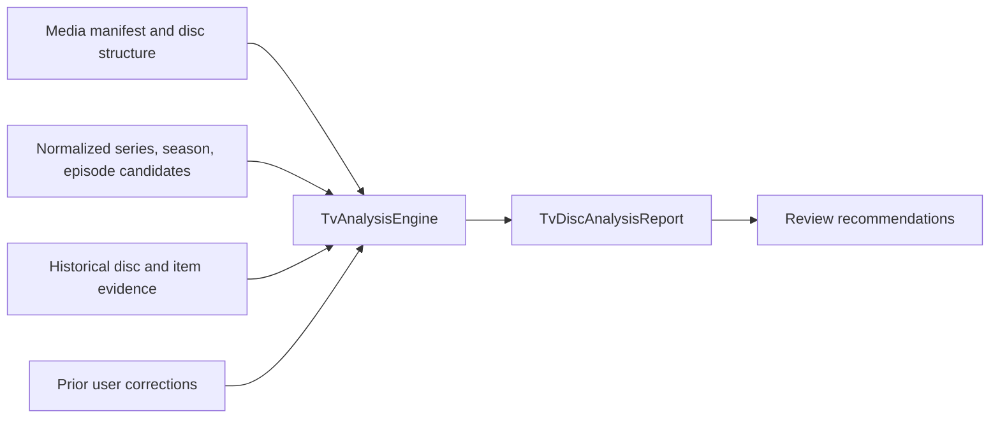

# AutoDisc TV Analysis and Episode Matching Engines

## Scope

The first Advanced TV Series increment adds a deterministic analysis engine
and report model. It analyzes a supplied media manifest alongside normalized
metadata candidates, prior disc analyses, and user corrections. It performs no
disc ripping, database writes, episode assignment, renaming, or UI/API work.
The DVD workflow is intentionally unchanged and does not invoke this engine.

## Input and output

`TvAnalysisEngine.analyze` accepts a `TvAnalysisInput`:

- Source and manifest IDs, an open media manifest, optional disc label,
  fingerprint, season/disc position and release ID.
- Normalized series, season and per-item episode metadata candidates. Provider
  IDs and confidence values are retained as evidence; this input is an
  integration boundary and does not make the engine call vendors.
- Historical disc identity, season/disc position, and prior episode matches
  indexed by stable item signatures.
- Prior user corrections, scoped to an exact disc fingerprint and item
  signature.

It returns a `TvDiscAnalysisReport` containing ranked series and season
candidates, a ranked candidate list for each item, probable episode candidates,
duplicate and alternate relationships, bonus/commentary/special-feature
classifications, confidence evidence, and recommended review actions. The
report deliberately has no selected episode or assignment operation.

## Episode matching engine

`TvEpisodeMatchingEngine.match` consumes the analysis report, optionally
supplemental normalized episode metadata, exact-disc feedback records, and
confidence/margin policy values. It returns a `TvEpisodeMatchReport` with a
per-track decision, candidate episode groupings, confidence, evidence, and
manual-review status.

- Single episode suggestions use analysis candidate confidence and retain
  provider, title, runtime, and history evidence.
- A multi-part title is suggested only when metadata explicitly supplies a
  complete group with consistent part numbers, part count, series/season, and
  consecutive episode numbers. The engine compares disc-title runtime to the
  sum of expected episode runtimes. Missing or inconsistent groups remain
  unknown; component episodes are not silently downgraded to single matches.
- Candidates must meet default confidence `0.72` and exceed the next
  candidate by at least `0.12`. Callers may tighten these thresholds. Otherwise
  the result is **Unknown** and includes evidence explaining why no match was
  selected.
- Probable duplicates, alternate versions, commentary, bonus material, and
  special features are distinct decisions and are not assigned as episodes.
  Duplicate episode claims across tracks become unknown.
- Output is a suggestion/report, not a workflow assignment: the engine does
  not write files, mutate analysis data, persist a decision, or invoke providers.

## Correction history persistence

`TvEpisodeFeedbackRepository` and SQLite migration 6 persist explicit human
feedback outcomes: `accepted`, `rejected`, and `manual-assignment`. Each record
is scoped to a disc fingerprint and stable item signature, stores one episode
for accept/reject or an ordered episode list for manual multi-episode
assignment, and may include an operator reason. Feedback is deterministic
historical evidence; there is no machine-learning behavior.

The matching engine applies feedback only when both report fingerprint and
item signature match. Accepted matches are surfaced as accepted, rejected
candidates are excluded with their reason retained, and manual assignments
are surfaced explicitly as user corrections. Future orchestration can load
these records through the repository contract and pass them to the engine
without modifying ripping providers.

## Scoring and evidence

All confidence values are finite and bounded to `[0, 1]`; malformed
identifiers, duplicate manifest item IDs, non-finite confidence, and invalid
durations produce explicit errors.

- **Series:** weighted average of metadata confidence (0.60), matching disc
  history (0.30), and similarity to the disc label or best track title (0.10),
  using only evidence that is present. A matching fingerprint contributes
  stronger historical support than a matching item signature.
- **Season:** metadata (0.55), history (0.30), and season number from disc
  structure (0.15), again normalizing over available evidence.
- **Disc position:** known structure (0.60) and matching history (0.40).
  When structure omits the disc number or count, the report can surface a
  history-supported position and its confidence instead of treating it as
  known input.
- **Episode:** metadata (0.50), runtime similarity (0.20), track/episode title
  similarity (0.10), and historical match (0.20), normalizing over available
  evidence. A matching prior user correction is surfaced at confidence `1.0`
  for review, but remains a candidate rather than an assignment.

Each ranked match includes component scores and human-readable evidence, such
as provider confidence, runtime difference, title overlap, fingerprint match,
or a prior correction reason. Ties are resolved deterministically.

## Track classification

Classification uses manifest kind, title and string attributes, available
episode candidates, and duration:

- Commentary wording is identified separately from other bonus material.
- Bonus terms include featurettes, trailers, interviews, deleted scenes, and
  behind-the-scenes content.
- Explicit special kinds and very short items are surfaced as special features.
- Items with episode candidates or a plausible feature-length runtime remain
  episode candidates unless they match a more specific classification.
- Repeated episode candidates, matching content fingerprints, near-identical
  titles/runtimes, and alternate-version wording produce probable duplicate or
  alternate relationships with their supporting evidence.

These are heuristics, not guarantees. A report recommends operator review
when series/season confidence is weak, episode candidates remain uncertain,
disc position is missing, or potential duplicate/alternate/bonus content is
found. It never instructs the application to rename or assign a track.

## Extension and remaining work

Metadata providers can be adapted to the normalized TV candidate types without
changing the scoring engine. History and correction sources are passed as
interfaces-by-data: the engine is pure and owns no database, network, clock,
global state, or provider lifecycle.

`TvWorkflowService` now calls both engines for structurally plausible TV DVDs,
persists confidence-gated plans, and consumes exact-disc corrections. The DVD
workflow holds these discs for review instead of treating them as movies.
However, there are still no built-in TV metadata providers, review endpoints or
screens, full report persistence, or TV file execution. See
[TV-WORKFLOW-INTEGRATION.md](./TV-WORKFLOW-INTEGRATION.md) for the workflow,
integration details, and blockers before a complete TV workflow.

## Test coverage

`test/tv-analysis-engine.test.js` verifies combined evidence scoring,
explainability, history and correction influence, duplicate/alternate
relationships, bonus/commentary/special classification, conservative
recommendations, lack of auto-assignment, and invalid-input errors.
`test/tv-episode-matching-engine.test.js` verifies confidence and ambiguity
gates, explicit multi-part groupings, unknown outcomes for incomplete or
conflicting candidates, duplicate/commentary/bonus handling, and human
feedback behavior. `test/database-migrations.test.js` verifies migration 6
and feedback repository persistence.
