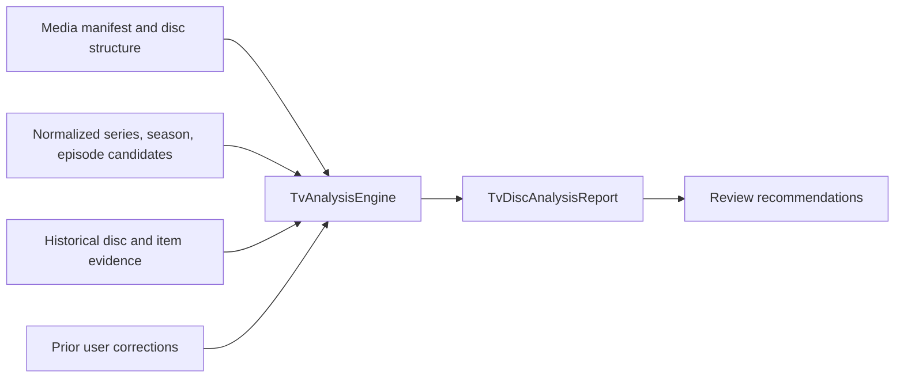

# AutoDisc TV Analysis Engine

## Scope

The first Advanced TV Series increment adds a deterministic analysis engine
and report model. It analyzes a supplied media manifest alongside normalized
metadata candidates, prior disc analyses, and user corrections. It performs no
disc ripping, database writes, episode assignment, renaming, or UI/API work.
The DVD workflow is intentionally unchanged and does not invoke this engine.

## Input and output

`TvAnalysisEngine.analyze` accepts a `TvAnalysisInput`:

- Source and manifest IDs, an open media manifest, optional disc label,
  fingerprint, season/disc position and release ID.
- Normalized series, season and per-item episode metadata candidates. Provider
  IDs and confidence values are retained as evidence; this input is an
  integration boundary and does not make the engine call vendors.
- Historical disc identity, season/disc position, and prior episode matches
  indexed by stable item signatures.
- Prior user corrections, scoped to an exact disc fingerprint and item
  signature.

It returns a `TvDiscAnalysisReport` containing ranked series and season
candidates, a ranked candidate list for each item, probable episode candidates,
duplicate and alternate relationships, bonus/commentary/special-feature
classifications, confidence evidence, and recommended review actions. The
report deliberately has no selected episode or assignment operation.

## Scoring and evidence

All confidence values are finite and bounded to `[0, 1]`; malformed
identifiers, duplicate manifest item IDs, non-finite confidence, and invalid
durations produce explicit errors.

- **Series:** weighted average of metadata confidence (0.60), matching disc
  history (0.30), and similarity to the disc label or best track title (0.10),
  using only evidence that is present. A matching fingerprint contributes
  stronger historical support than a matching item signature.
- **Season:** metadata (0.55), history (0.30), and season number from disc
  structure (0.15), again normalizing over available evidence.
- **Disc position:** known structure (0.60) and matching history (0.40).
  When structure omits the disc number or count, the report can surface a
  history-supported position and its confidence instead of treating it as
  known input.
- **Episode:** metadata (0.50), runtime similarity (0.20), track/episode title
  similarity (0.10), and historical match (0.20), normalizing over available
  evidence. A matching prior user correction is surfaced at confidence `1.0`
  for review, but remains a candidate rather than an assignment.

Each ranked match includes component scores and human-readable evidence, such
as provider confidence, runtime difference, title overlap, fingerprint match,
or a prior correction reason. Ties are resolved deterministically.

## Track classification

Classification uses manifest kind, title and string attributes, available
episode candidates, and duration:

- Commentary wording is identified separately from other bonus material.
- Bonus terms include featurettes, trailers, interviews, deleted scenes, and
  behind-the-scenes content.
- Explicit special kinds and very short items are surfaced as special features.
- Items with episode candidates or a plausible feature-length runtime remain
  episode candidates unless they match a more specific classification.
- Repeated episode candidates, matching content fingerprints, near-identical
  titles/runtimes, and alternate-version wording produce probable duplicate or
  alternate relationships with their supporting evidence.

These are heuristics, not guarantees. A report recommends operator review
when series/season confidence is weak, episode candidates remain uncertain,
disc position is missing, or potential duplicate/alternate/bonus content is
found. It never instructs the application to rename or assign a track.

## Extension and remaining work

Metadata providers can be adapted to the normalized TV candidate types without
changing the scoring engine. History and correction sources are passed as
interfaces-by-data: the engine is pure and owns no database, network, clock,
global state, or provider lifecycle.

Before this engine can drive a production TV workflow, AutoDisc still needs
TV metadata adapters and mapping/validation, persistence for analysis history
and corrections, disc-title segmentation and multi-episode modeling, an
orchestration integration point, confidence/review policy validation against
real discs, and an operator correction experience. Automatic assignment,
episode naming, publishing, multi-drive support, and UI work are explicitly
outside this increment.

## Test coverage

`test/tv-analysis-engine.test.js` verifies combined evidence scoring,
explainability, history and correction influence, duplicate/alternate
relationships, bonus/commentary/special classification, conservative
recommendations, lack of auto-assignment, and invalid-input errors.
