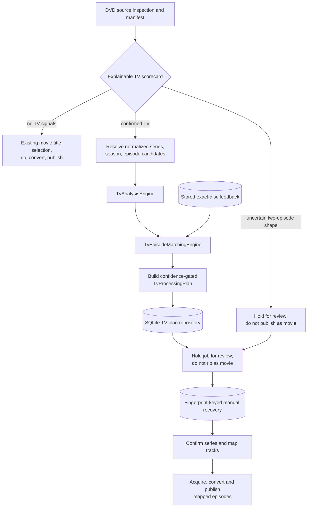

# AutoDisc v2 TV Workflow Integration

## Scope and safety boundary

The DVD workflow builds a TV-prefilter scorecard for every inspected disc.
The scorecard records the final classification, heuristic confidence, and
each passed or failed criterion in the service log and job history. An explicit
season/series/episode label or at least three episode-length titles with
consistent runtimes and no longer feature title is classified as TV. Two or
more episode-length titles that do not meet the confirmed-TV rule are
considered uncertain and held for review rather than routed to movie
publishing, including when runtimes are inconsistent or a longer title is
present. Bonus/commentary-named titles are excluded from the structural
signal. Discs without these signals follow the movie path, with the failed
criteria and score explaining that decision.

The confidence is a weighted heuristic score, not a probability or a learned
model. It communicates which available signals supported the routing decision.

For a potential series disc, the DVD workflow generates a TV analysis report,
runs the episode matching engine, builds a confidence-gated processing plan,
and persists it. It records a review-state job and does not acquire/rip a title
as a movie. This prevents a likely TV disc from being published as one movie.
Detected and final physical/media classifications are persisted separately by
disc fingerprint. A reviewer can explicitly choose TV Series for a disc
classified as a movie, enter/import series metadata, and map detected tracks
to one or more episodes.

Automatic suggestions remain analysis-only: they never trigger TV output.
When a user has saved series metadata and episode-to-track mappings, the DVD
workflow can acquire and convert those mapped titles into Jellyfin-style
Series/Season folders. It rejects incomplete episode mapping, invalid tracks,
cross-season multi-episode groups, and output collisions. Outputs created
during a failed run are rolled back when possible; existing files are never
overwritten. Manual choices are loaded by fingerprint before automatic
classification, so subsequent insertions restore the user's work.

Settings include a validated TV root output path. Validation can create the
root directory and reports write permissions and available disk space; path
failures create a deduplicated Review Centre configuration issue. The root is
used for explicitly mapped TV episode publishing; Series/Season directories
are created only by manual-recovery processing.

The Disc Diagnostics page exposes the persisted classification scorecard,
TV analysis and matching reports, metadata provider outcomes, and per-job
pipeline events. TV candidate lists and confidence scores are evidence for
review, not automatic episode assignments or publishing instructions.

## Workflow diagram

## Integration services and contracts

- `TvWorkflowService` adapts generic metadata provider results into TV domain
  candidates, parses explicit season/disc identifiers, invokes both existing
  engines, loads exact item-signature feedback, builds a plan, and persists it.
- `TvProcessingPlan` contains series, season and disc position; per-item
  suggested episodes, confidence bands and explanations; duplicate and
  alternate tracks; commentary, bonus and special features; review reasons;
  automatic-safety determination; approval requirement; and an explicit
  execution blocker.
- `TvReviewService` accepts correction actions and persists accepted,
  rejected, and manual assignments. Accepted/rejected choices must refer to
  candidates present in the plan; manual assignments may describe multi-part
  episodes. Future runs load and apply matching fingerprint/item-signature
  feedback deterministically. A reviewer can approve a manually-reviewed
  low-confidence plan, but this does not change its automatic-safety rating.
  Explicit recovery mappings are separately stored and do not adopt automatic
  suggestions. No machine learning is performed.
- Authenticated REST endpoints and the dashboard expose TV analysis, episode
  matching, corrections, and plan review. The universal Review Centre also
  presents TV plan holds with recovery forms for physical/media overrides,
  provider lookup, manual episode entry, dropdown mapping, and drag-and-drop.
  Explicitly mapped DVD titles are encoded to the TV root path.
- SQLite migration 7 persists JSON processing plans and their review/approval
  state, including reviewer identity, review timestamp, and rejection reason.
  Plans are available through the repository for future API work.
- SQLite migration 8 captures the manifest, metadata candidates, analysis and
  match reports, confidence policy, plan, and correction snapshot in the
  validation evidence repository. Later plan reviews/corrections are included
  when captured evidence is reported or exported. See
  [TV-VALIDATION.md](./TV-VALIDATION.md) for import/export, held-out feedback
  comparison, and known algorithm assumptions.
- SQLite migration 9 adds persistent universal review items. See
  [V2-ARCHITECTURE.md](./V2-ARCHITECTURE.md) for Review Centre fields,
  filters, endpoints, retry behavior, and the audio-CD destination recovery
  workflow.
- SQLite migration 19 adds fingerprint-keyed detected/final classification,
  provider, series/season, notes, and manual episode-mapping persistence. See
  [TV-MANUAL-RECOVERY.md](./TV-MANUAL-RECOVERY.md) for API, provider
  limitations, output conventions, and recovery behavior.

## Confidence policy

- **High:** confidence at least `0.90`. A plan is safe for automatic episode
  mapping only when series, season, disc position and all episode-bearing
  tracks are high confidence, there are no unresolved duplicate/alternate
  relationships, and there are no manual-review flags.
- **Medium:** confidence from `0.72` to below `0.90`. Recommend review; do not
  mark the plan safe for automatic processing.
- **Low:** confidence below `0.72`, absent required identity/position, unknown
  candidates, or ambiguity. Require review.

An overall plan score uses the minimum confidence across required series,
season, disc-position and episode evidence, avoiding a high metadata score
concealing a weak track. Confidence measures mapping evidence and does not
authorize automatic publishing; only explicitly saved user mappings drive
TV output.

## TV metadata providers

TVDB and TMDB TV lookup is registered with the production metadata resolver
through `ConfiguredTvMetadataProvider`. Provider selection, fallback,
health-aware failover, optional cache, and lookup auditing are managed outside
the analysis and matching engines. Metadata candidates include the
`itemId`, `seriesId`, `seasonNumber`, `episodeNumber`, title, and runtime
evidence consumed by the existing analysis workflow.

Provider lookup results remain suggestions and can still be incomplete,
ambiguous, or incorrect. A lookup failure leaves the workflow's conservative
unknown/review-required behavior in place. TVDB and TMDB support direct series
and season lookups, while IMDb IDs are resolved through TMDB. AniDB direct
lookup is not currently implemented. See
[`TV-METADATA-SETTINGS.md`](./TV-METADATA-SETTINGS.md) for configuration and
API details.

## Remaining blockers

### Before full Version 2 TV workflow / Archivist Mode

1. Add local/user metadata adapters and stronger runtime validation for
   provider payloads; TVDB and TMDB TV adapters are available.
2. Validate the prefilter against varied real DVD box sets, anime, specials,
   bonus-heavy releases, region differences, and discs with incomplete labels.
3. Collect representative validation cases, including known prefilter
   false-positives and false-negatives; see
   [TV-VALIDATION.md](./TV-VALIDATION.md). Evidence capture is implemented,
   but broad physical-disc validation and calibrated accuracy measurement are
   still outstanding.
4. Complete correction conflict, correction audit, retry, and reprocessing
   policies for end-to-end TV workflow use.
5. Validate manual episode output, atomic publication/rollback, cleanup, and
   library target handling against a representative set of physical discs.
6. Validate confidence thresholds and duplicate/alternate heuristics on
   representative real discs before allowing any unattended processing.

### Before Multi-Drive Support

1. Add stable drive identity and discovery/provider contracts across drives.
2. Replace the global single-active-job constraint and single drive fingerprint
   state with per-drive state, queueing, leases, and resource claims.
3. Make cancellation, recovery, ejection, and review plans drive-aware.
4. Add scheduling, retry, disk-space admission, and bounded concurrency rules.

Neither multi-drive behavior nor platform support is part of this integration.
