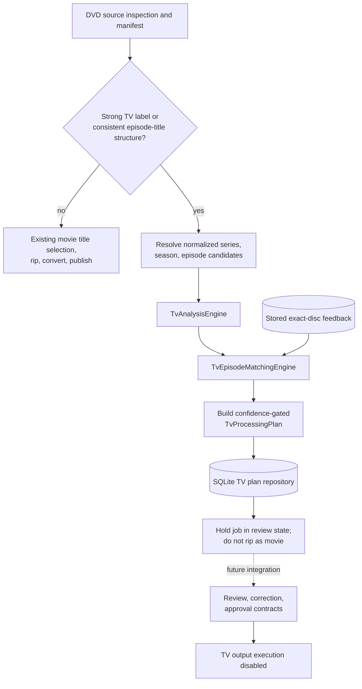

# AutoDisc v2 TV Workflow Integration

## Scope and safety boundary

The DVD workflow now invokes TV analysis only for discs with strong television
signals: an explicit season/series/episode label, or at least three
episode-length titles with reasonably consistent runtimes and no longer
feature title. Bonus/commentary-named titles are excluded from the structural
signal. Other discs continue through the existing movie path without TV
metadata lookups.

For a potential series disc, the DVD workflow generates a TV analysis report,
runs the episode matching engine, builds a confidence-gated processing plan,
and persists it. It records a review-state job and does not acquire/rip a title
as a movie. This prevents a likely TV disc from being published as one movie.
Movie title selection, movie output folder/path, conversion, cleanup, and
ejection behavior are unchanged when the disc does not meet the TV prefilter.

TV output execution remains disabled. Even a plan classified as safe for
automatic processing cannot currently trigger ripping, conversion, renaming,
folder creation, movement, or publication. The disc is held for future review
or integration; it is not ejected by the TV branch.

## Workflow diagram

## Integration services and contracts

- `TvWorkflowService` adapts generic metadata provider results into TV domain
  candidates, parses explicit season/disc identifiers, invokes both existing
  engines, loads exact item-signature feedback, builds a plan, and persists it.
- `TvProcessingPlan` contains series, season and disc position; per-item
  suggested episodes, confidence bands and explanations; duplicate and
  alternate tracks; commentary, bonus and special features; review reasons;
  automatic-safety determination; approval requirement; and an explicit
  execution blocker.
- `TvReviewService` accepts correction actions and persists accepted,
  rejected, and manual assignments. Accepted/rejected choices must refer to
  candidates present in the plan; manual assignments may describe multi-part
  episodes. Future runs load and apply matching fingerprint/item-signature
  feedback deterministically. A reviewer can approve a manually-reviewed
  low-confidence plan, but this does not change its automatic-safety rating or
  enable TV execution. No machine learning is performed.
- Review, correction and approval action types define the transport-neutral
  contract for future review screens. No UI or review REST endpoints are
  included.
- SQLite migration 7 persists JSON processing plans and their review/approval
  state, including reviewer identity, review timestamp, and rejection reason.
  Plans are available through the repository for future API work.

## Confidence policy

- **High:** confidence at least `0.90`. A plan is safe for automatic episode
  mapping only when series, season, disc position and all episode-bearing
  tracks are high confidence, there are no unresolved duplicate/alternate
  relationships, and there are no manual-review flags.
- **Medium:** confidence from `0.72` to below `0.90`. Recommend review; do not
  mark the plan safe for automatic processing.
- **Low:** confidence below `0.72`, absent required identity/position, unknown
  candidates, or ambiguity. Require review.

An overall plan score uses the minimum confidence across required series,
season, disc-position and episode evidence, avoiding a high metadata score
concealing a weak track. Confidence measures the quality of mapping evidence;
it does not mean TV file execution is implemented.

## Current metadata limitation

The existing production metadata providers are TMDB movie and MusicBrainz
album providers. The workflow asks the generic metadata resolver for `series`,
`season`, and `episode` entities, but those built-in providers abstain. Thus a
season-labeled DVD can produce a complete **unknown/review-required** plan
until a TV provider is registered. A provider can participate through the
existing generic metadata contract by returning validated TV metadata payloads
with the documented `itemId`, `seriesId`, `seasonNumber`, `episodeNumber`,
runtime, and optional multipart fields.

## Remaining blockers

### Before full Version 2 TV workflow / Archivist Mode

1. Add TVDB/TMDB-TV/local/user metadata adapters and strict runtime validation
   for metadata payloads. No built-in provider currently returns TV entities.
2. Validate the prefilter against varied real DVD box sets, anime, specials,
   bonus-heavy releases, region differences, and discs with incomplete labels.
3. Persist full analysis/match reports and the provider inputs used, not only
   the resulting processing plan and correction feedback.
4. Add review/approval REST endpoints and a UI; define correction conflict,
   correction audit, retry, and reprocessing policies.
5. Implement safe TV acquisition/segmentation, multi-episode output policy,
   naming templates, atomic publication, cleanup/recovery, and library target
   handling. Execution intentionally remains disabled until these exist.
6. Validate confidence thresholds and duplicate/alternate heuristics on
   representative real discs before allowing any unattended processing.

### Before Multi-Drive Support

1. Add stable drive identity and discovery/provider contracts across drives.
2. Replace the global single-active-job constraint and single drive fingerprint
   state with per-drive state, queueing, leases, and resource claims.
3. Make cancellation, recovery, ejection, and review plans drive-aware.
4. Add scheduling, retry, disk-space admission, and bounded concurrency rules.

Neither multi-drive behavior nor platform support is part of this integration.
