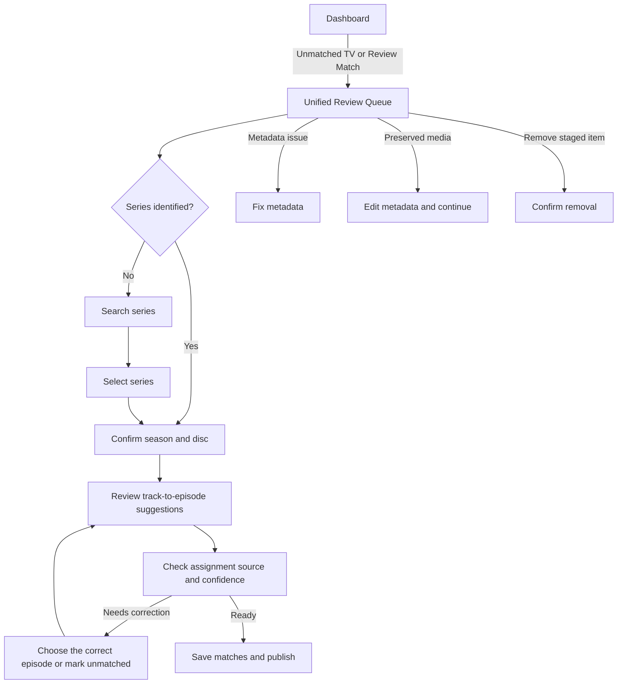

# AutoDisc UX and Navigation Audit

Date: 2026-10-19

## Scope and implementation context

The web interface is a vanilla HTML/CSS/JavaScript single-page application served by AutoDisc. It is not a React/Electron frontend, so this redesign follows the existing SPA, page renderer, and API patterns rather than introducing a new framework.

The audit covered all seven authenticated application page routes, the separate first-run setup route, navigation links, dashboard destinations, review entry points, TV matching and analysis surfaces, dialogs, and the settings form. The main workflow data is already available through the dashboard, review, review-job, TV matching, TV review, and TV summary APIs.

## Navigation audit

| Existing surface | Existing responsibility | Audit finding | New location |
|---|---|---|---|
| Dashboard | Live job, system resources, conversion chart, latest discs, TV intelligence and provider activity | Useful overview, but it did not summarize or prioritize items needing action | Dashboard with five workflow summary cards and a conditional attention panel |
| Disc Diagnostics | Live disc/job inspection, classification, TV identification evidence, provider details, processing log and resolved storage paths | Valuable support surface, but its name hid its storage and troubleshooting role | Storage → Paths & Diagnostics |
| History | Completed and past jobs | Distinct, low-friction lookup task | Library → Media History |
| TV Disc Review | Staged TV discs, episode mapping, removal and unmatched-track actions | Duplicated the staged TV task cards already rendered by Review Centre | Queue section in the Unified Review Queue |
| TV Analysis | Recent TV processing plans and evidence | Overlapped with episode suggestions | Combined TV Identification page |
| Episode Matching | Suggested episode candidates and explanations | Same TV identification workflow as TV Analysis; separate navigation added a context switch | Episode suggestions section on the TV Identification page |
| Review Centre | Review records, preserved-media jobs, TV tasks and TV plans | Already aggregated the main attention streams, but TV work was lower on the page and had a competing entry point | Unified Review Queue, with TV discs and plans surfaced first |
| TV Validation | Labeled cases, corrections, accuracy and validation reports | Complements TV and processing statistics rather than needing its own top-level destination | Activity & Insights |
| Statistics | Processing totals and TV workflow metrics | Duplicated summary information already shown elsewhere | Activity & Insights |
| Settings | One long form covering software, output/storage, encoding, metadata, music, library organization, TV providers/processing, Lidarr and administrator access | Settings fields were in one form, not duplicated; users needed better access to relevant groups | Settings navigation anchors; Storage also links directly to the single Storage & Output card |
| First-run Setup (`/setup`) | Two-step administrator credential setup while processing APIs are unavailable | Purposeful one-time wizard, isolated from normal navigation; no overlapping application destination | Retained as a standalone onboarding route |

Dialogs remain contextual rather than becoming navigation destinations: TV identification, staged-track preview, deletion confirmations, music metadata, directory selection, login, and password change. The `/setup` route is a separate first-run bootstrap flow, not a sidebar entry.

### New primary navigation (6 entries)

1. Dashboard
2. Library — Media History
3. Tasks — Review Queue; Activity & Insights
4. Identification — TV Matching & Analysis
5. Storage — Paths & Diagnostics; Storage & Output
6. Settings — General; Integrations; Advanced

The sidebar uses expandable groups, so the top-level count is six including Dashboard. There is no standalone movie/TV library browser in the current application; History is therefore labelled Media History rather than implying an unimplemented library view.

## Merged screens

- **TV Disc Review + TV review tasks in Review Centre:** one staged-disc and episode-plan section at the top of the Unified Review Queue. Track matching, identify/change series, delete unmatched tracks, and remove-disc actions remain available.
- **TV Analysis + Episode Matching:** one TV Identification page with both the plan analysis and explainable episode suggestions.
- **TV Validation + Statistics:** one Activity & Insights page with processing totals, TV workflow totals, validation summaries, insights, cases, and report details.
- **Review entry points:** TV discs/plans, general review records, and preserved-media continuation remain distinct work types but share one queue page and are no longer split across primary navigation.
- **Settings access:** one settings form remains authoritative. Sidebar entries scroll to the existing General, Integrations, Advanced, and Storage & Output sections rather than creating duplicate forms or settings.

## Removed screens and obsolete components

- Removed the standalone TV Disc Review page and its refresh control; its queue was already rendered by the TV review loader.
- Removed the standalone Episode Matching page; its renderer now appears within TV Identification.
- Removed the standalone Statistics page; processing and TV statistics now appear with validation.
- Removed the old four-card dashboard processing-total strip. The equivalent processing totals remain available on Activity & Insights; the dashboard uses its space for work and attention summaries.
- Removed route branches, navigation items, and refresh handling for the merged pages. No TV matching, deletion, review, history, validation, or settings capability was intentionally removed.

## Implemented UX changes and rationale

- **Five Dashboard summaries:** Active Tasks, Waiting For Review, Unmatched TV Content, Failed Identifications, and Recent Activity make work state visible without opening separate pages.
- **Conditional attention alert:** lists current attention counts and exposes context-aware Review Match, Fix Metadata, Continue Processing, Remove Item, and Open Review Queue shortcuts. Each shortcut opens the relevant queue section; destructive actions still require their existing explicit confirmation.
- **One-click queue access:** dashboard summaries and alert actions navigate directly to the matching queue section.
- **TV queue ordering:** staged TV discs and episode plans are first in the queue because these often block publishing and require direct correction.
- **TV identification step indicator:** the series-search and season/disc steps are explicit; episode review and saving remain visible as the next workflow step.
- **Assignment provenance:** TV plans and staged-track suggestions identify TVDB/provider disc mapping, sequential assignment, runtime ranking, history, or manual assignment. Candidate confidence is presented as a plain-language band and percentage; confirmed manual assignments are labelled as confirmed.
- **Grouped navigation and settings anchors:** reduces a ten-link sidebar to six workflow-oriented entries and avoids duplicating settings fields.

## New user workflow

For a disc with confident series, season, and disc identification, provider disc mapping and sequential fallback remain backend assignment strategies; the review UI makes the resulting source visible instead of asking users to infer it from runtime scores.

## Future UX improvements

1. Add persistent queue filters and sorting by urgency, age, media type, and failure category.
2. Add keyboard-first episode selection, bulk accept, and a compact track-to-episode table for multi-track discs.
3. Add explicit provider identity to each mapping provenance record where it is available, rather than relying on the selected series provider.
4. Add an in-page “next item” action that preserves the current correction context and advances through the queue.
5. Add responsive visual QA at narrow/mobile widths and accessibility testing with keyboard-only and screen-reader workflows.
6. Measure time-to-resolution, queue abandonment, and correction rates before further workflow changes.

## Verification checklist

- Sidebar has six top-level entries.
- TV unmatched work is reachable from Dashboard in one click.
- Review Match, Fix Metadata, Continue Processing, and Remove Item actions navigate to the relevant queue and retain existing safeguards.
- TV task and plan assignment cards expose source and understandable confidence.
- Merged routes still load their existing renderers and actions.
- Processing totals remain available on Activity & Insights.
