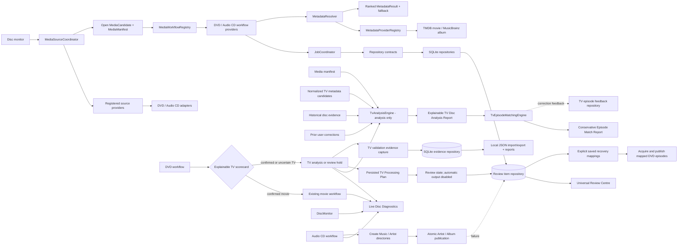

# AutoDisc v2 Platform Architecture

**Status:** Historical platform overview, extended by
[TV-MANUAL-RECOVERY.md](./TV-MANUAL-RECOVERY.md). The v2 provider foundation,
TV analysis/matching, validation evidence, universal Review Centre, and
fingerprint-keyed TV metadata recovery are implemented. Explicitly confirmed
episode mappings can drive DVD TV output; automatic suggestions remain
analysis-only. Real-disc validation and provider coverage remain outstanding.

**Implementation progress:** The source-provider seam now uses open media
domain models, and source candidates dispatch through a registered
media-workflow registry rather than source-kind branches in the core pipeline.
TMDB movie lookup and MusicBrainz album lookup use metadata-provider contracts,
health checks, candidate ranking, and fallback results. SQLite connection,
migrations, and settings/job/history/event/recovery repositories are separated
behind repository contracts; `db.ts` remains a compatibility facade for
non-workflow callers. DVD and audio-CD workflows use the injected job
coordinator for lifecycle state and cancellation context. The standalone
`TvAnalysisEngine` produces explainable disc reports, and
`TvEpisodeMatchingEngine` ranks single and explicitly grouped multi-part
episode suggestions, returning unknown when confidence or separation is
insufficient. The DVD workflow now calls `TvWorkflowService` for strongly
identified TV discs; it stores a confidence-gated plan and holds the disc for
review instead of sending it through movie output. SQLite migrations 6 and 7
add feedback and processing-plan repositories. Migration 19 adds durable
detected/final classification, provider/series metadata, and episode mappings.
Migration 8 stores end-to-end TV evidence and supports local dataset exchange
and reports. See
[TV-VALIDATION.md](./TV-VALIDATION.md) for the evidence format, tooling, and
known assumptions.
Migration 9 adds the persistent universal Review Centre. Authenticated
dashboard/API review actions expose filtering, details, and supported recovery;
audio-CD publishing creates and verifies `Music/Artist/Album` destinations
before atomic publication.
AutoDisc registers a `ConfiguredTvMetadataProvider` adapter with the
production `MetadataResolver`. Provider selection, fallback, health-aware
failover, optional provider-aware caching, and lookup metrics are handled
outside the analysis and matching engines. Metadata results contribute
candidate evidence only; explicit user mappings, never automatic assignments,
drive TV publishing.
See
[`TV-METADATA-SETTINGS.md`](./TV-METADATA-SETTINGS.md).
See [V2-MIGRATION-REPORT-2026-10-19.md](./V2-MIGRATION-REPORT-2026-10-19.md)
for the current diagram, gate status, extension points, and feature blockers.
See [TV-ANALYSIS-ENGINE.md](./TV-ANALYSIS-ENGINE.md) for its input, scoring,
report, and remaining integration work.
See [TV-WORKFLOW-INTEGRATION.md](./TV-WORKFLOW-INTEGRATION.md) for the
workflow integration, confidence gates, and Archivist Mode/multi-drive blockers.

## Current implementation shape



The media source coordinator does not inspect media-kind-specific fields.
Source-specific selection and output handling belongs to registered workflow
providers. Built-in providers and workflows are currently registered
statically at the composition root; runtime package discovery, provider-owned
configuration schemas, and dynamic administration UI are not implemented.

## Universal Review Centre and Audio CD publishing

Migration 9 stores TV and CD reviews, metadata issues, processing failures,
folder-creation failures, disc-read errors, validation warnings, configuration
issues, and system warnings. Review records retain severity, status,
timestamps, job/disc/drive context, error details, the requested path, and
suggested actions. Authenticated REST endpoints at `/api/v1/reviews` provide
summary counts, category/severity/status/date filters, item details and job
logs, resolve/dismiss operations, and safe retry requests. The dashboard keeps
TV plan approvals while presenting these cross-workflow items in the Review
Centre.

Audio CD publishing recursively creates and verifies the configured Music
root and sanitized artist directory. Tracks remain in a private staging
directory until the completed album can be atomically renamed into a
collision-safe `Artist/Album` destination. Destination and publication errors
create a folder-creation review with filesystem error and parent permission
details; retry checks the destination parent and asks the optical-disc monitor
to rescan rather than leaving an empty album directory behind.

Disc Diagnostics is a dashboard page over the live detection snapshot and
persisted per-job event timeline. It does not run a separate polling or system
metrics sampler. See [DISC-DIAGNOSTICS.md](./DISC-DIAGNOSTICS.md) for its API,
data coverage, and provider limitations.

## 1. Architectural objective

AutoDisc v2 should be a media-ingestion platform, not a collection of DVD,
Jellyfin, and Linux-specific conditionals. New media types, devices, metadata
sources, libraries, notification channels, and operating systems should be
added behind stable contracts and registered at the composition root.

The extensibility goal is deliberately practical: a feature should normally be
implemented by adding a module, its contract implementation, configuration
schema, and tests. Core changes should be limited to a genuinely new
cross-cutting concept, a versioned contract change, or a new orchestration
capability—not edits to a chain of media-type or provider-specific branches.

AutoDisc remains a self-hosted application with a small operational footprint.
The architecture does not require microservices, a remote database, a
third-party plugin marketplace, or background metrics collection.

## 2. Design principles and boundaries

1. **Domain before integrations.** Jobs, media identities, artifacts,
   capabilities, and lifecycle states are domain concepts. Names of external
   products and operating systems do not appear in domain rules.
2. **Ports and adapters.** Core orchestration depends on typed interfaces
   (ports); OS APIs, MakeMKV, FFmpeg, metadata APIs, and media servers are
   adapters.
3. **Composition-root dependency injection.** A single startup composition
   root constructs and validates implementations, then injects them into
   services. Domain modules do not import concrete providers or read global
   process state.
4. **Capability-based selection.** Select a registered provider by declared
   capabilities, configuration, media kind, and health—not by scattered
   `if (provider === "jellyfin")` checks.
5. **Events for facts, interfaces for commands.** Durable domain events report
   facts after a committed state change. Explicit service interfaces perform
   commands and return results. Events are not a hidden substitute for
   request/response behavior.
6. **Versioned contracts.** Provider API, event envelope, and persisted
   configuration have explicit versions, validation, compatibility rules, and
   migration paths.
7. **Safe defaults and bounded resources.** Concurrency, retries, storage,
   process lifetime, provider calls, and event retention have configurable
   limits and conservative defaults.
8. **Observable but idle when idle.** Persist job and operational facts;
   sample live host metrics only while a dashboard or authorized metrics
   consumer is connected.

## 3. Target module layout

```text
src/
  bootstrap/                 composition root, configuration, module registry
  contracts/                 public provider interfaces and versioned events
  domain/                     media, source, job, artifact, policy, errors
  application/                use cases, workflow planner, queue coordinator
  ports/                      persistence, process runner, clock, platform
  infrastructure/
    database/                 SQLite repositories and migrations
    events/                   transactional outbox and event dispatcher
    api/                      REST/SSE transport, auth, validation
    web/                      static dashboard
    platform/                 Linux, Windows, macOS implementations
  providers/
    sources/                  DVD, Blu-ray, UHD, watch-folder, file import
    libraries/                generic collection, Jellyfin, Plex, Emby
    metadata/                 TMDB, TVDB, Fanart.tv, custom providers
    notifications/            Discord, email, Home Assistant, webhook
    drives/                    optical, USB, internal, future device adapters
    transforms/               remux, transcode, audio extraction, validation
  plugins/                    trusted, explicitly installed extension packages
```

The layout is a dependency rule, not a requirement for one file per feature.
`domain` must not import from `providers`, `infrastructure`, or operating
system packages. Providers implement contracts; application use cases call
contracts; bootstrap owns all concrete wiring. Provider modules can depend on
domain types and their own implementation libraries.

## 4. Core contracts

Contracts use TypeScript types at compile time and runtime schemas at every
external boundary. The following are illustrative v2 interfaces; final names
and exact types are settled in the contract implementation milestone.

```ts
interface ProviderDescriptor {
  id: string;                 // stable namespaced id, e.g. "jellyfin"
  apiVersion: string;         // supported provider contract range
  capabilities: string[];
  configSchema: JsonSchema;
}

interface Provider {
  describe(): ProviderDescriptor;
  initialize(context: ProviderContext): Promise<void>;
  healthCheck(): Promise<ProviderHealth>;
  dispose(): Promise<void>;
}

interface MediaSourceProvider extends Provider {
  discover(signal: AbortSignal): AsyncIterable<SourceCandidate>;
  inspect(candidate: SourceCandidate, signal: AbortSignal): Promise<MediaManifest>;
  acquire(candidate: SourceCandidate, target: Workspace, signal: AbortSignal):
    Promise<AcquiredMedia>;
}

interface MetadataProvider extends Provider {
  identify(input: IdentificationInput, signal: AbortSignal):
    Promise<IdentificationResult>;
}

interface LibraryProvider extends Provider {
  plan(input: PublishInput, signal: AbortSignal): Promise<PublishPlan>;
  publish(plan: PublishPlan, signal: AbortSignal): Promise<PublishResult>;
}

interface NotificationProvider extends Provider {
  send(message: NotificationMessage, signal: AbortSignal): Promise<void>;
}

interface DriveProvider extends Provider {
  enumerate(signal: AbortSignal): Promise<DriveDescriptor[]>;
  watch(signal: AbortSignal): AsyncIterable<DriveEvent>;
  inspect(driveId: string, signal: AbortSignal): Promise<DriveState>;
  eject?(driveId: string, signal: AbortSignal): Promise<void>;
}
```

Providers declare capabilities separately from implementation identity. For
example, a source can advertise `video.disc.dvd` and `video.disc.bluray`, while
a transform advertises accepted media/container/codecs and hardware
requirements. The workflow planner composes compatible capabilities. Unsupported
capability combinations fail during planning with a useful diagnostic, not
partway through a rip.

Every provider operation receives an abort signal, structured logger, typed
configuration, and scoped services from `ProviderContext`. It must not create
its own global server, database, scheduler, or unbounded background loop.

### Provider lifecycle and failure policy

- Discover and validate registrations at startup; reject duplicate IDs,
  unsupported API versions, invalid schemas, and unresolved required
  capabilities explicitly.
- Initialize enabled providers in declared dependency order. A noncritical
  provider failure marks that integration unavailable and reports its health;
  it must not silently substitute a different provider or disable unrelated
  workflows. A required workflow dependency prevents that workflow from being
  scheduled with a clear reason.
- Shutdown in reverse initialization order and await provider disposal.
- Apply timeouts, cancellation, bounded retries, and circuit-breaking at
  provider boundaries. Retrying an operation requires an idempotency key or a
  contract that the operation is safe to repeat.
- Provider health is event-driven or requested on demand; do not add an
  unbounded poller for each integration.

## 5. Ingestion workflow and media-source extensibility

All source types produce a normalized `SourceCandidate`, `MediaManifest`, and
one or more immutable `MediaArtifact` records. A candidate identifies where
media came from; a manifest describes discovered streams/tracks and stable
technical facts; an artifact identifies verified bytes plus checksum, format,
size, and provenance. No source is allowed to write directly into a final
library location.

```text
source discovery
  -> durable candidate + deduplication key
  -> inspect / media manifest
  -> workflow plan from source and transform capabilities
  -> acquire into isolated workspace
  -> identify metadata (optional, ranked providers)
  -> operator review if policy requires it
  -> transform / validate / checksum
  -> library publish plan
  -> atomic publish or provider-specific import
  -> cleanup and final job event
```

DVD, Blu-ray, UHD Blu-ray, watch folders, and manual file imports are separate
source providers. Optical sources use a shared `DriveProvider` abstraction for
enumeration, insertion/removal events, state inspection, and optional eject.
One source implementation must not know how a different source discovers
media. Watch-folder and import providers use filesystem adapters and the same
queue, metadata, transform, publication, and history workflows.

For a multi-step job, the persisted plan records provider IDs and versions,
capability choices, metadata decision, transform settings, destination, and
idempotency keys. Recovery resumes only operations whose inputs and side
effects can be verified; otherwise the job is marked recoverable/needs-review
with its workspace preserved according to retention policy.

## 6. Metadata, transforms, and media libraries

### Metadata

Metadata providers return normalized candidates with source attribution,
confidence, external IDs, and field-level provenance. A `MetadataResolver`
applies configured ranking and match thresholds; it does not contain
TMDB/TVDB-specific logic. Providers include TMDB, TVDB, Fanart.tv, and custom
implementations. Manual entry is a first-class resolver outcome and does not
require changing a provider.

Cache provider responses by provider, query identity, and locale with explicit
expiry. Store secrets in a separate secret store interface; never serialize
credentials into jobs, logs, events, or API responses.

### Transformations

Transforms are registered capabilities with declared accepted inputs,
produced artifacts, resource needs, configuration schema, and validation
policy. The planner chooses a compatible path from source artifact to desired
output. Ripping, remuxing, transcoding, audio extraction, tagging, and
verification are composable steps—not branches in the queue coordinator.
Provider outputs are validated before publication; failed validation never
looks like success.

### Libraries

`LibraryProvider` plans a safe destination and publication method. Generic
media collections use a filesystem implementation and configurable templates;
Jellyfin, Plex, and Emby integrations are optional providers that can add
server-side refresh or import behavior. A library plugin cannot change the
ingested source or the durable job state machine. Publish operations use
staging and atomic rename where supported and preserve idempotency across
recovery.

## 7. Drive and platform abstraction

The application domain uses stable drive IDs and capabilities, not `/dev/sr0`,
Windows device paths, or macOS device nodes. Platform adapters translate
native enumeration, events, permissions, process launch, eject, filesystem,
hardware acceleration, and service lifecycle into ports.

- Linux provider: udev and Linux optical-device APIs, systemd packaging.
- Windows provider: device notifications, Windows process/filesystem APIs,
  Windows service/installer packaging.
- macOS provider: IOKit/device notifications, process/filesystem APIs, launchd
  packaging.

DVD, Blu-ray, UHD, USB, internal, and future hardware support compose a device
provider with one or more source/acquisition providers. A platform adapter may
expose only capabilities the host actually supports. Missing tools, device
access, codecs, or hardware acceleration are reported as explicit capability
and health results; no adapter claims support based only on a hardware label.

Platform-specific code is isolated behind ports, but the application remains
portable only when a feature's required capability exists. A cross-platform
claim requires CI and hardware-independent integration tests on each supported
OS, plus documented target-device validation where physical hardware is
required.

## 8. Queue, scheduling, and resource policy

`QueueCoordinator` owns durable job admission and scheduling. It supports
priority, not-before scheduling, batches, retry policies, and multiple workers
without embedding source-specific logic. Each job declares resource claims
(drive IDs, CPU/GPU class, workspace/storage budget, and optional exclusive
locks). A configurable resource scheduler grants claims before steps run.

Defaults remain conservative: one optical acquisition per physical drive,
bounded transform concurrency, bounded child processes, and no resource
oversubscription. Independent sources may run in parallel when their claims do
not conflict. Priority aging prevents starvation. Scheduled jobs use persisted
UTC instants and are recalculated after restart. Retry policy is explicit per
failure class; user cancellation, invalid media, configuration errors, and
permanent provider errors are not blindly retried.

Use a relational SQLite queue for the self-hosted single-node target. Keep
repositories behind ports so a future deployment can replace storage without
changing use cases. SQLite transactions guarantee job transitions and the
outbox event are committed together. Queue leases and heartbeats support
crash recovery and stale-worker detection; they are not a promise of
multi-host/distributed scheduling in v2.

## 9. Durable events, statistics, and API

Use a transactional outbox. A state transition and its versioned event are
written in one database transaction, then dispatched to in-process subscribers
and SSE clients. Events carry `eventId`, `eventType`, `schemaVersion`,
`occurredAt`, `jobId`/resource identity, and a typed payload. Consumers must
handle duplicate delivery and unknown event versions safely. Events are
append-only facts; commands go through application use cases.

Initial event families include:

- `source.discovered`, `media.inspected`, `artifact.created`
- `job.queued`, `job.started`, `job.step.completed`, `job.retry.scheduled`,
  `job.completed`, `job.failed`, `job.cancelled`
- `drive.discovered`, `drive.state.changed`, `drive.health.reported`
- `provider.health.changed`, `library.publish.completed`
- `notification.delivery.completed` / `notification.delivery.failed`
- `user.activity.recorded`

Statistics are projections over durable events and job records: processing
metrics, storage analytics, drive read/error/usage metrics, and user activity.
Projection code subscribes to normalized facts; adding a metric does not add a
conditional to ripping or library code. Live CPU/RAM/GPU sampling is a separate
on-demand telemetry provider that starts only while an authorized dashboard
metrics session is active.

The REST API exposes stable domain resources (`jobs`, `sources`, `drives`,
`libraries`, `providers`, `settings`, `statistics`) and versioned schemas.
Provider-specific configuration and health are namespaced by provider ID.
SSE carries authorized status and telemetry events; it is not a command
transport. The UI queries a provider registry for available integrations and
their schemas rather than hard-coding a list of vendor-specific settings.

## 10. Persistence model

SQLite remains the default. Core tables are provider-neutral:

| Table | Purpose |
|---|---|
| `jobs` | Source identity, state, priority, schedule, retry policy, lease, timestamps |
| `job_steps` | Planned step/provider version, inputs, outputs, attempts, status, error |
| `media_sources` | Source provider ID, stable source identity, drive/path metadata |
| `media_manifests` | Normalized titles, streams, tracks, technical facts |
| `artifacts` | Workspace/final references, checksums, format, provenance, validation |
| `metadata_matches` | Provider-attributed candidates and chosen/manual resolution |
| `provider_configs` | Provider ID, schema version, enabled state, nonsecret config |
| `secret_refs` | References to secret-store entries; never secret values in jobs |
| `event_outbox` | Versioned durable events, delivery status, retry timestamps |
| `statistics_projection` | Rebuildable aggregate counters and analytics |
| `schema_migrations` | Ordered, checksummed database migration history |

Do not store plugin-defined arbitrary columns in core tables. Extensible
provider metadata belongs in validated, versioned JSON documents namespaced by
provider; query-critical common fields remain normalized. Migrations are
forward-only, transactional where possible, tested against a copy of the
previous release database, and retain a backup/rollback procedure.

## 11. Configuration, registration, and plugin safety

Built-in providers and explicitly installed trusted extensions register through
the same registry contracts. Registration is explicit in bootstrap; avoid
magical filesystem scanning or running every package found in a directory.
Each registration provides its descriptor, factories, schemas, capability
claims, and dependency declarations.

Configuration is namespaced (`providers.<providerId>`) and validated against
the provider's schema. The core owns general policies (storage, concurrency,
retention, authentication); providers own their nonsecret options. Secret
values are passed at initialization from `SecretStore`. A missing or invalid
provider configuration is reported at startup or surfaced as that integration
unavailable; it never silently resets to defaults.

Version 2 starts with built-in providers and a documented, semver-governed
extension SDK. Third-party code is trusted code: in-process extensions have
the host process's privileges and are not a security sandbox. Do not expose
arbitrary URL-based installation or runtime code downloads. Require explicit
installation/enablement and operator approval. If untrusted community plugins
are later needed, design a separate process/RPC boundary with capability
permissions, resource limits, signed artifacts, and revocation; do not imply
that TypeScript interfaces provide isolation.

## 12. Error handling, recovery, and observability

Use typed error categories such as invalid input/media, capability unavailable,
provider transient/permanent, resource exhausted, cancelled, integrity failure,
and internal fault. Errors include stable codes, safe operator-facing detail,
retryability, provider/step identity, and a correlation/job ID. Do not swallow
errors or convert them into success-shaped results.

Every external process/API call has timeout and cancellation behavior. Capture
bounded stdout/stderr and redact secrets. Never log credentials or sensitive
media paths unless explicitly configured. Recovery reconciles leases,
workspace files, artifacts, outbox deliveries, and destination state before
resuming or requiring operator review.

Diagnostics show enabled provider capabilities and health, unavailable
features, queue claims, current step, retry decision, and cleanup status.
Metrics collection remains demand-driven; event-backed historical analytics
does not require a constant host sampling loop.

## 13. Security and operational model

Keep the current single-user deployment model as the default, but put auth,
authorization, secret storage, filesystem access, provider configuration, and
network binding behind explicit services and policy. Provider code must not
inherit unrestricted administrative APIs unless required and disclosed.
Validate library destinations against configured roots; guard against path
traversal, symlink escapes, archive bombs, and partial publication. Use
least-privilege process execution and configurable executable paths.

Linux/systemd remains the first v2 deployment target. Windows and macOS support
are platform-adapter and packaging milestones, not reasons to scatter OS
branches across the application.

## 14. Delivery roadmap and architecture gates

### Gate A — seams before features

- Inventory v1 responsibilities and extract domain types, ports, application
  use cases, adapters, and a composition root without changing observable v1
  behavior.
- Add runtime-validated provider descriptors and registry; register current
  DVD, audio CD, MakeMKV, FFmpeg, filesystem, MusicBrainz, and Jellyfin/Lidarr
  behavior as built-in adapters.
- Introduce contract tests for each provider and a fake provider suite for
  hardware-independent workflows.
- Write and test data migrations from released v1 databases.

**Gate:** existing DVD/CD workflows and API behavior pass regression tests;
startup reports missing optional providers clearly; no domain module imports a
vendor or OS adapter.

### Gate B — event and job foundation

- Extract transactional job coordinator, step ledger, leases, event outbox,
  idempotency, cancellation, and recovery.
- Add resource claims with defaults preserving single-drive serial behavior.
- Add event-based statistics projections and on-demand telemetry provider.

**Gate:** crash/restart and duplicate-event tests prove no duplicate publish,
lost completion event, silent failed step, or unbounded retry.

### Gate C — provider expansion

- Add new source, metadata, transform, library, notification, and drive
  providers one at a time through the SDK.
- Add settings schema discovery and provider health to the API/UI.
- Add watch-folder/file import, additional libraries, and notification
  integrations without adding vendor branches to core orchestration.

**Gate:** a reference provider can be added in its provider package plus
registration/configuration, contract tests, and documentation; core queue and
domain workflow files remain unchanged.

### Gate D — multi-device and advanced queue

- Add multiple drives, bounded independent parallel jobs, priority, schedules,
  batches, and configurable failure-class retry policies.
- Validate fairness, resource claims, storage reservation, and recovery under
  contention before raising default concurrency.

**Gate:** tests cover scheduling across restart, starvation, drive exclusivity,
resource exhaustion, cancellation, and partial batch failure.

### Gate E — other operating systems

- Implement and test Windows and macOS platform adapters, installers, service
  lifecycle, permissions, hardware capability discovery, and diagnostics.
- Keep Linux integration behavior unchanged and supported.

**Gate:** CI runs core contracts and integration suites on all claimed
platforms; hardware requirements and unsupported capabilities are explicit.

## 15. Acceptance criteria for future changes

Before merging a v2 feature, answer:

1. Is this a domain rule, a provider, or platform infrastructure? Is it in the
   corresponding boundary?
2. Can a new provider be added by implementing contracts and registering it,
   without changing provider-neutral orchestration?
3. Are capability claims, runtime schemas, lifecycle, health, timeout,
   cancellation, idempotency, and failure policy explicit?
4. Are persisted settings/events versioned and migrated?
5. Are secrets, permissions, paths, and external outputs handled safely?
6. Are contract tests independent of physical drives, vendor services, and
   specific operating systems?
7. Does the feature respect queue resource claims and idle-resource goals?
8. Is operator-facing failure visible and recoverable?
9. Does documentation describe the extension contract and required setup?
10. If a core file must change, is the new behavior truly cross-cutting, and
    are existing providers protected by regression tests?

An architecture review may approve core changes where the extension point
itself must evolve. “Never touch core” is not a substitute for a coherent,
versioned contract.
