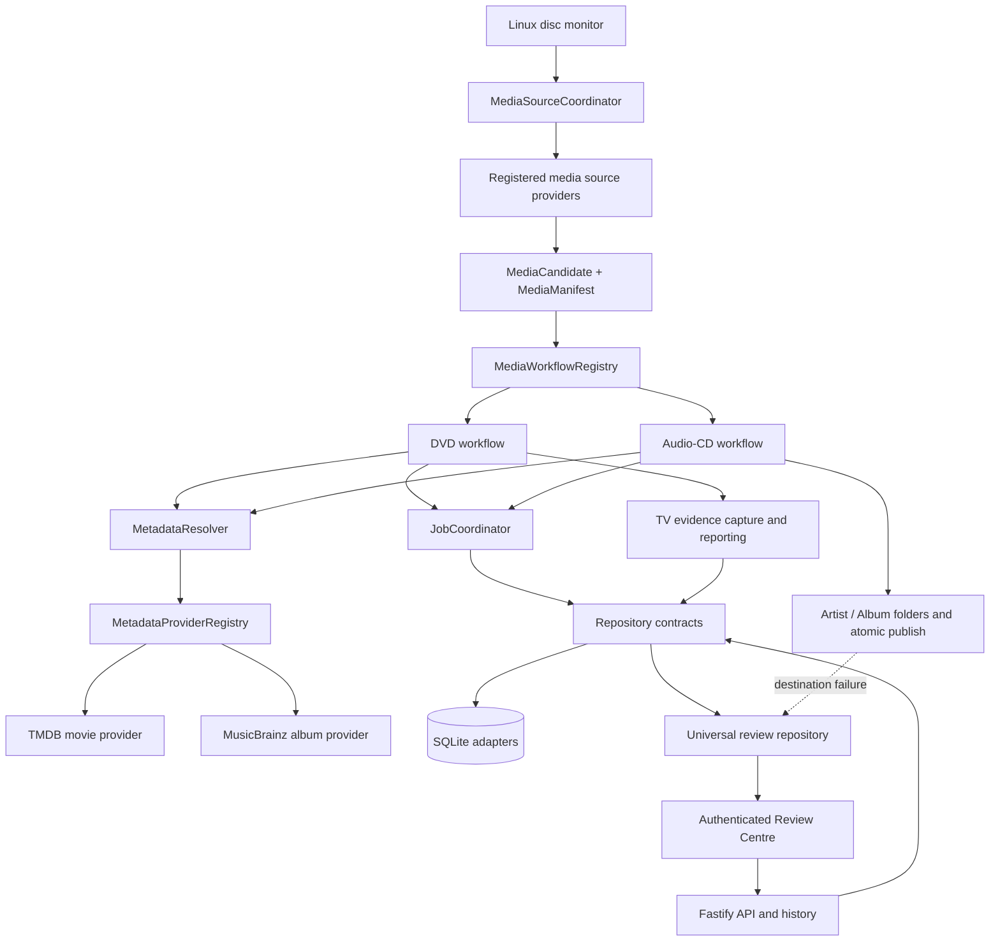

# AutoDisc v2 Migration Progress

**Date:** 2026-10-19
**Release:** `v1.9.0` on `main`

This report tracks the Version 2 architecture, TV intelligence, validation
evidence, and universal Review Centre delivered in v1.9.0. TV output execution,
parallel jobs, multi-drive processing, and new library integrations remain out
of scope. The v1.9.2 follow-up now includes TVDB/TMDB TV metadata lookup,
provider failover, caching, and audit metrics; see
[TV-METADATA-SETTINGS.md](./TV-METADATA-SETTINGS.md).

> Historical snapshot: this report describes the v1.9.0 state as of 2026-10-19.
> v1.15.2 later added explicitly mapped DVD TV episode publishing and manual
> metadata recovery. Automatic TV suggestions still do not trigger publishing;
> see [TV-MANUAL-RECOVERY.md](./TV-MANUAL-RECOVERY.md) for current behavior.

## Updated architecture diagram

The coordinator handles provider identity, validation, inspection, and
acquisition dispatch without a closed media-kind union. The separate workflow
registry resolves a handler by its registered media kind; a new source and
workflow can be added without editing either registry's dispatch algorithm.
The workflow implementation itself remains responsible for its media-specific
domain behavior.

## Migration progress

| Gate | Status | Delivered in this increment |
|---|---|---|
| Provider-neutral media domain | **Foundation complete** | Added `MediaSource`, `MediaCandidate`, `MediaManifest`, `MediaArtifact`, and `MediaAcquisitionResult`; removed DVD/audio-CD unions from the source coordinator contract. DVD and audio-CD adapters produce generic manifests/artifacts. |
| Source workflow dispatch | **Foundation complete** | Added `MediaWorkflowRegistry`; moved the DVD and audio-CD branches out of `pipeline.ts` into registered workflow providers. |
| Metadata providers | **Foundation complete; configuration partial** | Added provider contract, health type, registry, resolver, title-similarity/popularity confidence scoring, ranking, fallback and per-provider failure reporting. TMDB movie and MusicBrainz album adapters are registered and injected into workflows. |
| Persistence/repositories | **SQLite adapter split complete; compatibility paths remain** | Separated connection setup, migrations, and settings/job/history/event/recovery SQLite repositories. Added repository interfaces and test coverage for old-schema upgrades. `db.ts` remains a compatibility façade for legacy API callers and startup settings access; monitor, recovery, and workflows use injected repository services. |
| Job coordination | **Foundation integrated** | Added job context, steps, results/failures, lifecycle status/event persistence, progress updates, terminal handling, and cancellation-control delegation. DVD/CD workflows consume the injected coordinator. Serial operation is unchanged. |
| TV-series workflow integration | **Integrated through plan generation; output execution disabled** | Structurally plausible TV DVDs go through `TvWorkflowService`, which calls both engines, consumes persisted feedback, stores a confidence-gated plan, and holds the job for review. Non-TV discs retain existing movie behavior. SQLite migrations 6 and 7 persist feedback and plans. TV ripping/output is not implemented. |
| TV validation evidence | **Capture, explain, import/export implemented** | Migration 8 stores disc manifests, metadata candidates, analysis/match reports, confidence evidence, plans and feedback snapshots. CLI tooling supports listing, summary, per-case reports, JSON export and atomic dataset import. Broad real-disc corpus validation and calibrated accuracy remain open. |
| Universal Review Centre | **Implemented** | Migration 9 persists cross-workflow review items. Authenticated APIs and the dashboard provide category/severity/status/date filters, summary counts, job details, resolve/dismiss, and supported retry actions. TV plan review remains available alongside general review items. |
| Audio CD destination publishing | **Implemented** | Music and sanitized artist directories are created and permission-checked before publication. Completed albums are atomically published under `Artist/Album`; collisions use a unique destination. Directory and publish failures create detailed, retryable review items. |
| Durable events, queue, platform and drive abstraction | **Not started** | Existing process-local events and Linux monitor remain; one active job and one configured optical device are still enforced. |

## Provider extension points

- **Media source:** implement `MediaSourceProvider`, emit a provider-neutral
  manifest, and return artifacts in `MediaAcquisitionResult`. The source
  coordinator does not need a new media-kind branch.
- **Workflow:** implement `MediaWorkflow` for the new media kind and register
  it in the composition root. Existing core dispatch stays unchanged.
- **Metadata:** implement `MetadataProvider.identify`, return candidates with
  confidence scores and metadata, and register it with
  `MetadataProviderRegistry`. `MetadataResolver` ranks candidates, records
  provider failures, and returns no selection when all providers abstain or
  fail.
- **Persistence:** depend on `AutoDiscRepositories` and its settings, jobs,
  history, events, recovery, TV evidence/feedback/plans, and review-item ports.
  The provided SQLite adapters preserve existing tables/data and can be
  replaced behind these interfaces.
- **Job execution:** use `JobCoordinator` with an injected `JobContext`, typed
  steps/results/failures, and shared repository/event services.
- **TV workflow:** `TvWorkflowService` composes the existing analysis and
  matching engines; `DvdWorkflow` branches to it for strong TV signals and
  persists/holds the plan without ripping as a movie.
- **TV review/correction:** `TvReviewService` records accepted, rejected, and
  manual one-or-more episode assignments in `TvEpisodeFeedbackRepository`.
  Later matching runs read exact-disc/item-signature feedback.
- **TV plans:** `TvProcessingPlanRepository` persists confidence, assignments,
  review requirements and output execution blocker for future review surfaces.
- **TV evidence:** `TvValidationService` and
  `TvValidationEvidenceRepository` capture immutable processing evidence,
  report decisions, and import/export versioned validation datasets. See
  [TV-VALIDATION.md](./TV-VALIDATION.md).
- **Universal reviews:** `ReviewItemRepository` persists operational review
  items. The Review Centre API and dashboard expose the lifecycle and recovery
  operations; audio destination failures retain requested paths and permission
  evidence.

## Created files

- `src/domain/media.ts`
- `src/domain/metadata.ts`
- `src/domain/television.ts`
- `src/application/tv-analysis-engine.ts`
- `src/application/tv-episode-matching-engine.ts`
- `src/application/tv-workflow-service.ts`
- `src/application/tv-review-service.ts`
- `src/application/tv-validation-service.ts`
- `src/domain/tv-validation.ts`
- `src/infrastructure/database/tv-episode-feedback-repository.ts`
- `src/infrastructure/database/tv-processing-plan-repository.ts`
- `src/infrastructure/database/tv-validation-evidence-repository.ts`
- `src/domain/reviews.ts`
- `src/infrastructure/database/review-item-repository.ts`
- `test/tv-analysis-engine.test.js`
- `test/tv-episode-matching-engine.test.js`
- `test/tv-workflow-service.test.js`
- `test/tv-validation.test.js`
- `docs/TV-WORKFLOW-INTEGRATION.md`
- `docs/TV-VALIDATION.md`
- `scripts/tv-validation.js`
- `docs/TV-ANALYSIS-ENGINE.md`
- `src/contracts/metadata-provider.ts`
- `src/contracts/repositories.ts`
- `src/contracts/job-control.ts`
- `src/application/media-workflow-registry.ts`
- `src/application/metadata-provider-registry.ts`
- `src/application/metadata-resolver.ts`
- `src/application/job-coordinator.ts`
- `src/infrastructure/database/connection.ts`
- `src/infrastructure/database/default-settings.ts`
- `src/infrastructure/database/migrations.ts`
- `src/infrastructure/database/repositories.ts`
- `src/infrastructure/database/settings-repository.ts`
- `src/infrastructure/database/job-repository.ts`
- `src/infrastructure/database/history-repository.ts`
- `src/infrastructure/database/event-repository.ts`
- `src/infrastructure/database/recovery-repository.ts`
- `src/providers/metadata/tmdb-movie.ts`
- `src/providers/metadata/musicbrainz.ts`
- `src/providers/workflows/audio-cd.ts`
- `src/providers/workflows/dvd.ts`
- `src/application/job-coordinator.ts`
- `src/contracts/repositories.ts`
- `src/infrastructure/database/review-item-repository.ts`
- `src/domain/reviews.ts`
- `test/job-coordinator.test.js`
- `test/media-workflow-registry.test.js`
- `test/metadata-architecture.test.js`

## Modified files

- `src/application/media-source-coordinator.ts`
- `src/bootstrap/providers.ts`
- `src/contracts/media-source.ts`
- `src/disc-monitor.ts`
- `src/index.ts`
- `src/model.ts`
- `src/music-pipeline.ts`
- `src/pipeline.ts`
- `src/providers/sources/audio-cd.ts`
- `src/providers/sources/dvd.ts`
- `src/db.ts`
- `src/job-control.ts`
- `src/server.ts`
- `web/index.html`
- `web/app.js`
- `web/style.css`
- `test/api.test.js`
- `test/audio-cd.test.js`
- `test/database-migrations.test.js`
- `test/updater.test.js`
- `src/recovery.ts`
- `README.md`
- `package.json`
- `package-lock.json`
- `test/media-source-coordinator.test.js`
- `test/provider-runtime.test.js`
- `docs/V2-ARCHITECTURE.md`
- `docs/ROADMAP.md`
- `docs/TV-ANALYSIS-ENGINE.md`
- `docs/TV-WORKFLOW-INTEGRATION.md`
- `docs/TV-VALIDATION.md`
- `docs/V2-MIGRATION-REPORT-2026-10-19.md`

Removed unused direct TMDB implementation `src/title.ts`; the production TMDB
adapter is now `src/providers/metadata/tmdb-movie.ts`.

## Remaining blockers before production TV-series support

1. TVDB/TMDB-TV lookup returns candidates, but provider ordering, episode
   ordering, and confidence scores still need validation against real discs.
2. The metadata candidate payload is intentionally generic; stronger runtime
   validation and local/user provider adapters remain future work.
3. Disc fingerprints still use label and manifest metadata rather than
   physical-disc identifiers or content hashes; distinct pressings can collide
   or the same disc can vary across providers.
4. Review and correction APIs/UI exist, but correction conflict, audit,
   retry, and reprocessing policies need to be completed for end-to-end TV
   workflow use.
5. TV output execution, multi-title segmentation, naming, publication, and
   cleanup policies remain unimplemented.
7. Confidence thresholds and duplicate/alternate heuristics require validation
   against representative physical discs before unattended processing.

## Remaining blockers before Multi-Drive Support

1. The monitor still watches one configured Linux device using udev/sysfs;
   there is no drive-provider contract, discovery service, or stable portable
   drive identity.
2. SQLite still enforces one active job globally, and inserted-disc
   fingerprint state is a single row. Per-drive state and durable resource
   claims are required before scheduling multiple drives.
3. The current operation/cancellation controller is process-local and
   single-operation. Per-drive cancellation, leases, restart recovery, and
   safe resource ownership are not implemented.
4. Ejection and several device assumptions remain concrete Linux helpers.
   Eject/read/monitor behavior needs a drive/platform adapter before a second
   device or another OS is supported.
5. There is no queue scheduler, retry policy, drive fairness, disk-space
   admission across concurrent jobs, or bounded parallel worker model.

## Validation

TV validation tooling and limitations are documented in
[TV-VALIDATION.md](./TV-VALIDATION.md). Evidence capture stores reports and
provider inputs, but the current counters are descriptive; confidence
calibration and correctness metrics require a trusted, manually labeled disc
corpus. The production TypeScript build and complete test run are recorded
after final verification.
