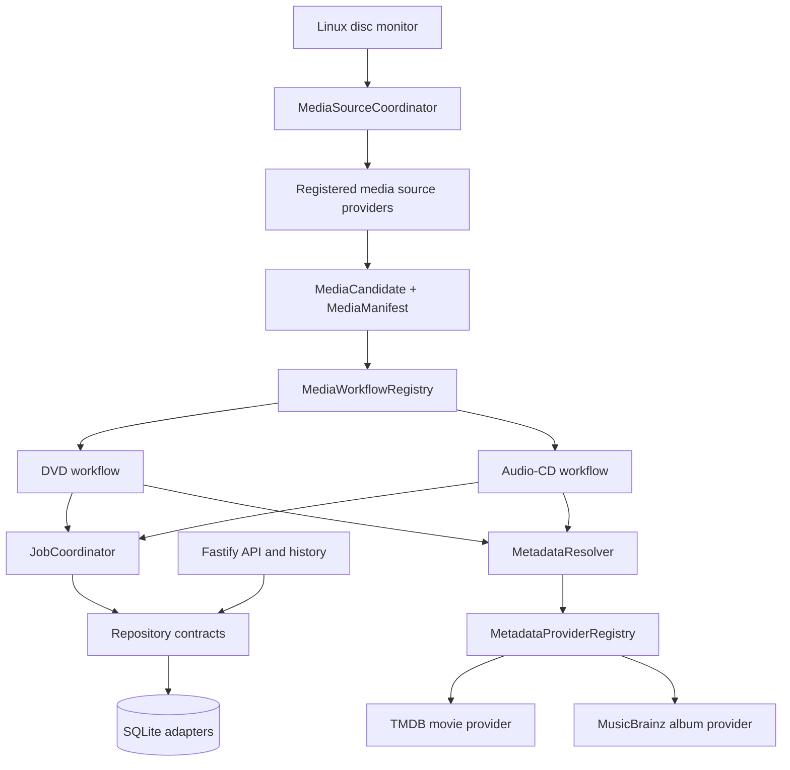

# AutoDisc v2 Migration Progress

**Date:** 2026-10-19
**Branch:** `roadmap/v2-planning`

This increment establishes architecture foundations only. It does not add
user-facing media features, TV episode detection, parallel jobs, multi-drive
processing, or new library integrations.

## Updated architecture diagram

The coordinator handles provider identity, validation, inspection, and
acquisition dispatch without a closed media-kind union. The separate workflow
registry resolves a handler by its registered media kind; a new source and
workflow can be added without editing either registry's dispatch algorithm.
The workflow implementation itself remains responsible for its media-specific
domain behavior.

## Migration progress

| Gate | Status | Delivered in this increment |
|---|---|---|
| Provider-neutral media domain | **Foundation complete** | Added `MediaSource`, `MediaCandidate`, `MediaManifest`, `MediaArtifact`, and `MediaAcquisitionResult`; removed DVD/audio-CD unions from the source coordinator contract. DVD and audio-CD adapters produce generic manifests/artifacts. |
| Source workflow dispatch | **Foundation complete** | Added `MediaWorkflowRegistry`; moved the DVD and audio-CD branches out of `pipeline.ts` into registered workflow providers. |
| Metadata providers | **Foundation complete; configuration partial** | Added provider contract, health type, registry, resolver, title-similarity/popularity confidence scoring, ranking, fallback and per-provider failure reporting. TMDB movie and MusicBrainz album adapters are registered and injected into workflows. |
| Persistence/repositories | **SQLite adapter split complete; compatibility paths remain** | Separated connection setup, migrations, and settings/job/history/event/recovery SQLite repositories. Added repository interfaces and test coverage for old-schema upgrades. `db.ts` remains a compatibility façade for legacy API callers and startup settings access; monitor, recovery, and workflows use injected repository services. |
| Job coordination | **Foundation integrated** | Added job context, steps, results/failures, lifecycle status/event persistence, progress updates, terminal handling, and cancellation-control delegation. DVD/CD workflows consume the injected coordinator. Serial operation is unchanged. |
| TV-series domain | **Models only** | Added series, season, episode, disc-analysis, episode-candidate, episode-match, and confidence types covering multi-disc context, specials, bonus/commentary items, alternate releases, duplicates, and manual corrections. |
| Durable events, queue, platform and drive abstraction | **Not started** | Existing process-local events and Linux monitor remain; one active job and one configured optical device are still enforced. |

## Provider extension points

- **Media source:** implement `MediaSourceProvider`, emit a provider-neutral
  manifest, and return artifacts in `MediaAcquisitionResult`. The source
  coordinator does not need a new media-kind branch.
- **Workflow:** implement `MediaWorkflow` for the new media kind and register
  it in the composition root. Existing core dispatch stays unchanged.
- **Metadata:** implement `MetadataProvider.identify`, return candidates with
  confidence scores and metadata, and register it with
  `MetadataProviderRegistry`. `MetadataResolver` ranks candidates, records
  provider failures, and returns no selection when all providers abstain or
  fail.
- **Persistence:** depend on `AutoDiscRepositories` and its settings, jobs,
  history, events, and recovery ports. The provided SQLite adapters preserve
  existing tables/data and can be replaced behind these interfaces.
- **Job execution:** use `JobCoordinator` with an injected `JobContext`, typed
  steps/results/failures, and shared repository/event services.
- **TV analysis:** build on the TV domain types; no provider or workflow
  implementation is included yet.

## Created files

- `src/domain/media.ts`
- `src/domain/metadata.ts`
- `src/domain/television.ts`
- `src/contracts/metadata-provider.ts`
- `src/contracts/repositories.ts`
- `src/contracts/job-control.ts`
- `src/application/media-workflow-registry.ts`
- `src/application/metadata-provider-registry.ts`
- `src/application/metadata-resolver.ts`
- `src/application/job-coordinator.ts`
- `src/infrastructure/database/connection.ts`
- `src/infrastructure/database/default-settings.ts`
- `src/infrastructure/database/migrations.ts`
- `src/infrastructure/database/repositories.ts`
- `src/infrastructure/database/settings-repository.ts`
- `src/infrastructure/database/job-repository.ts`
- `src/infrastructure/database/history-repository.ts`
- `src/infrastructure/database/event-repository.ts`
- `src/infrastructure/database/recovery-repository.ts`
- `src/providers/metadata/tmdb-movie.ts`
- `src/providers/metadata/musicbrainz.ts`
- `src/providers/workflows/audio-cd.ts`
- `src/providers/workflows/dvd.ts`
- `test/database-migrations.test.js`
- `test/job-coordinator.test.js`
- `test/media-workflow-registry.test.js`
- `test/metadata-architecture.test.js`

## Modified files

- `src/application/media-source-coordinator.ts`
- `src/bootstrap/providers.ts`
- `src/contracts/media-source.ts`
- `src/disc-monitor.ts`
- `src/index.ts`
- `src/model.ts`
- `src/music-pipeline.ts`
- `src/pipeline.ts`
- `src/providers/sources/audio-cd.ts`
- `src/providers/sources/dvd.ts`
- `src/db.ts`
- `src/job-control.ts`
- `src/server.ts`
- `src/recovery.ts`
- `README.md`
- `test/media-source-coordinator.test.js`
- `test/provider-runtime.test.js`
- `docs/V2-ARCHITECTURE.md`
- `docs/ROADMAP.md`

Removed unused direct TMDB implementation `src/title.ts`; the production TMDB
adapter is now `src/providers/metadata/tmdb-movie.ts`.

## Remaining blockers before Advanced TV Series Support

1. No TVDB/TMDB-TV/local/user metadata providers, series/episode search
   contracts, or TV-specific provider configuration and health reporting.
2. The metadata candidate payload is intentionally generic and not yet
   normalized into validated movie/series/season/episode schemas. The existing
   manual MusicBrainz release-ID API remains a direct integration path.
3. There is no disc-to-episode segmentation/matching workflow, multi-episode
   title handling, confidence policy for episode matches, or operator
   correction persistence.
4. TV domain objects are models only; there are no repositories or migrations
   for series, seasons, episodes, alternatives, duplicate relationships, or
   correction history.
5. Transform and library publication behavior remains in concrete workflow
   implementations. TV folder templates and library-provider contracts are
   not yet in place.
6. Provider-owned configuration schemas and generic provider configuration
   UI/API remain unimplemented; current settings still contain existing
   TMDB/MusicBrainz-specific fields.

## Remaining blockers before Multi-Drive Support

1. The monitor still watches one configured Linux device using udev/sysfs;
   there is no drive-provider contract, discovery service, or stable portable
   drive identity.
2. SQLite still enforces one active job globally, and inserted-disc
   fingerprint state is a single row. Per-drive state and durable resource
   claims are required before scheduling multiple drives.
3. The current operation/cancellation controller is process-local and
   single-operation. Per-drive cancellation, leases, restart recovery, and
   safe resource ownership are not implemented.
4. Ejection and several device assumptions remain concrete Linux helpers.
   Eject/read/monitor behavior needs a drive/platform adapter before a second
   device or another OS is supported.
5. There is no queue scheduler, retry policy, drive fairness, disk-space
   admission across concurrent jobs, or bounded parallel worker model.

## Validation

The production TypeScript build passes. Focused architecture/API checks passed
for provider-neutral source routing, metadata candidate ranking and fallback,
legacy SQLite migration, repository adapters, job coordination, and API
compatibility. The complete test run is recorded after final verification.
